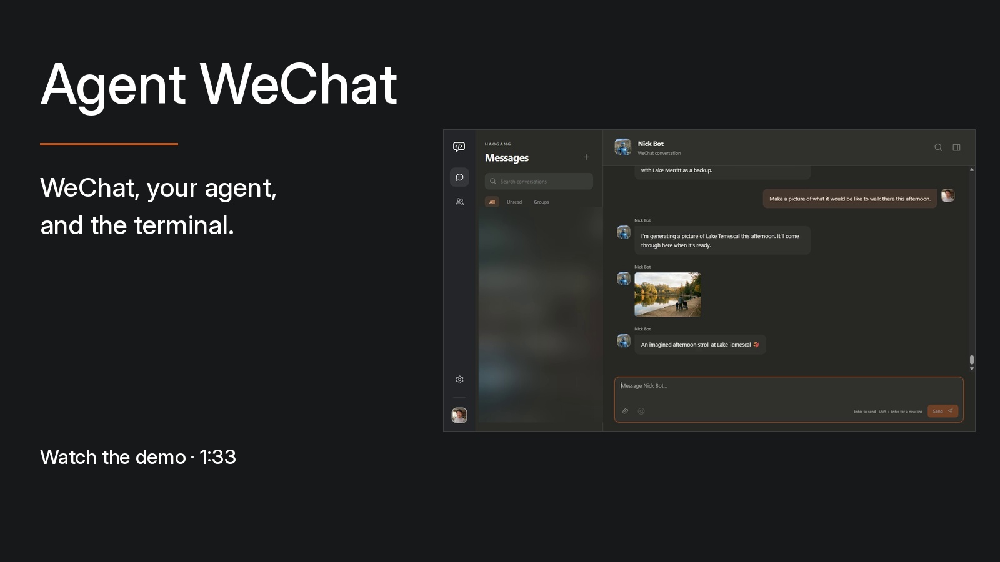
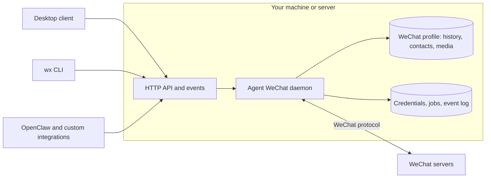

# Agent WeChat

**An open source WeChat client for people and AI agents.**

Use an alternative WeChat desktop client, work from the terminal, or connect your
AI agent. Read your conversations, exchange media, and build your own tools on the
same API. Agent WeChat communicates directly with WeChat; its daemon does not
need the official app running.

[Get started](#get-started) · [Documentation](https://thisnick.github.io/agent-wechat/) · [OpenClaw](#openclaw) · [Downloads](https://github.com/thisnick/agent-wechat/releases)

## See it in action

[](https://www.youtube.com/watch?v=T5LgL4n1MOQ)

[Watch the 93-second demo](https://www.youtube.com/watch?v=T5LgL4n1MOQ) ·
[Download the video](docs/public/demo/agent-wechat-demo.mp4)

One conversation with Nick Bot: a question from the phone, a voice reply, an image
request in the desktop client, and saving the result from the terminal. The
recording shows the build used for this demo; current setup and platform status
are linked below.

### A desktop interface


### Your WeChat, from the terminal


## Get started

### Desktop app

1. Download the installer for your platform from [GitHub Releases](https://github.com/thisnick/agent-wechat/releases).
2. Choose **Use this device** to run a local hub, or **Connect to another hub**.
3. Add a WeChat profile and follow the sign-in instructions on your phone.

The app includes the chat interface, native hub, and `wx` CLI. See the
[desktop guide](https://thisnick.github.io/agent-wechat/setup/desktop/) for
installers, system requirements, connection keys, and networking. Desktop
packaging and installed-app acceptance vary by platform; check the
[platform status](PLATFORM-ACCEPTANCE.md) and release notes for the build you use.

### Terminal and API

Install the native CLI with npm, then start its daemon:

```bash
npm install -g @agent-wechat/cli
wx --json version
wx serve
```

Allow the package's install script so it can download and verify the native
executable. [Installation alternatives](https://thisnick.github.io/agent-wechat/setup/install/)
include pnpm, standalone binaries, and Docker. Install FFmpeg and FFprobe on the
daemon host for voice/video preparation; the desktop app bundles them.

For an existing supported **WeChat for Linux** profile, close the official app,
back up its files, and run in a second terminal:

```bash
wx auth login --official
wx accounts list
wx chats list
wx messages list filehelper --limit 5
```

Keep the official app closed while the daemon uses that profile. To create a
separate profile instead, see [Connect your account](https://thisnick.github.io/agent-wechat/setup/connect/).
A new profile does not receive your complete old chat history. With several
accounts, select one using `--account ID_OR_ALIAS`.

Once connected, inspect a conversation and save an attachment:

```bash
wx contacts find Alice
wx messages list CHAT_ID --limit 20
wx messages media CHAT_ID MESSAGE_ID --output ./saved-image.jpg
```

See [CLI examples](https://thisnick.github.io/agent-wechat/use/cli/),
[API documentation](https://thisnick.github.io/agent-wechat/use/api/), and
[hosting options](https://thisnick.github.io/agent-wechat/setup/run/).

## WeChat features

| Area | What you can do |
| --- | --- |
| Conversations | Use DMs and groups; browse and search locally stored history; read unread counts and mark chats read. |
| Messages | Send and receive text, images, videos, files, and voice notes; recall eligible own messages and display incoming recalls. |
| Images and video | Preview and download available quality variants, including original images/video; send normal or original-quality video. |
| Voice | Play received notes and send audio as native voice notes. Longer audio can split into multiple notes; playback validation for longer notes remains incomplete. |
| Rich content | Read embedded quotes, link-card metadata, and forwarded conversations. Forwarded bundles become text; their nested attachments remain placeholders. |
| Stickers | Retrieve supported ordinary/shared stickers, including animated originals. Sending stickers and managing packs are unsupported. |
| Mentions | Send real member mentions or mention everyone where permitted; inspect incoming mention metadata. |
| Contacts and groups | Find contacts/groups, read member lists and avatars, and refresh saved metadata. |
| Group management | Create/rename/leave groups, add/remove members, set your group display name, clear announcements, and mute notifications, subject to account permissions. Some profile updates remain partial. |
| Organization | Pin/unpin supported chats and mute/unmute ordinary contacts and groups. |
| Media storage | Configure per-account automatic downloads, save verified media, and inspect transfer progress and unavailable-media status. |
| Desktop | Conversation search, media views, quote navigation, mention picker, native file saving, tray behavior, and notifications. See platform acceptance status above. |
| Automation | Use the `wx` CLI or authenticated HTTP API; follow replayable events and inspect send/download jobs. |

Outgoing quoted replies and link-card sends are implemented but still await live
recipient validation. Media availability depends on the received source, supported
formats, and size limits. Search covers stored history, not all remote history.
See [message types](https://thisnick.github.io/agent-wechat/how-it-works/message-types/),
[media](https://thisnick.github.io/agent-wechat/use/media/),
[groups](https://thisnick.github.io/agent-wechat/use/groups/), and the
[implementation and validation checklist](packages/native-client-rust/FEATURES.md).

## Use your existing official profile

Agent WeChat can read and continue supported writes in an existing official
WeChat for Linux profile **in place**. It retains the account identity and uses
its stored conversations, contacts, groups, and media.

| Profile data | Read | Write |
| --- | --- | --- |
| Messages | Stored history and supported rich content | Newly received and accepted outgoing messages; supported recall updates |
| Contacts | Saved contact metadata and avatars | Supported metadata received through WeChat sync |
| Groups | Details, rosters, names, and notification settings | Supported synchronized fields and group-operation results; some updates remain partial |
| Media | Supported cached images, video, files, and voice | Supported downloaded/sent cache files and associated resource records |
| Conversation state | Conversations, unread state, supported pin/mute settings | Supported read-state, pinning, and notification updates |
| Saved sign-in | Supported saved account/device information, when WeChat accepts it | Supported accepted sign-in and routing updates |

Offline profile commands can inspect supported stored history, contacts, groups,
and media without a daemon or network connection, using source-preserving
snapshots and the required keys. Contact writes here mean synchronized metadata;
they do not imply arbitrary friend creation, deletion, or editing.

Existing-profile compatibility targets recognized Linux layouts. Unknown files
are preserved and unsupported database layouts are refused. General official
search-index maintenance, arbitrary profile migration, and seamless switching
back to the official app are not established. Copy/import/export workflows remain
experimental. See the [native profile guide](packages/native-client-rust/README.md).

## OpenClaw

Connect an agent to WeChat with the `@agent-wechat/agent-wechat` plugin:

```bash
openclaw plugins install @agent-wechat/agent-wechat
```

Then follow [OpenClaw setup](https://thisnick.github.io/agent-wechat/openclaw/setup/)
to select the account, create a scoped token, and configure who the agent answers.
DMs and groups are disabled until configured. Replies use the connected account.

| Feature | Support |
| --- | --- |
| DMs and groups | Receive allowed messages and reply in the same WeChat thread. |
| Multimodal input | Images for compatible vision models; local file/video/voice attachments; voice transcription through OpenClaw's configured runtime. |
| Multimodal output | Text, images, videos, files, and native voice notes. Ordinary audio can remain a file. |
| Group context and mentions | Per-group behavior, real @mention gating, permitted unmentioned messages as context, and outgoing member/everyone mentions. |
| Access policies | Separate DM/group policies, sender allowlists, and per-group overrides. |
| Current-chat tools | `wechat_history`, `wechat_search`, `wechat_message`, and `wechat_media` for stored history and verified attachment retrieval. |
| Optional archive access | `wechat_archive_*` tools can list/search/read all chats in the configured account when granted by agent tool policy. |
| Message actions | `wechat_recall`; quoted replies through `message.replyTo` and link cards through `wechat_send_share` have the live-validation limits noted above. |
| Login assistance | `wechat_login` can inspect status, show a login QR, wait for approval, disconnect, log out, or explicitly forget local authentication. |
| Group information | `wechat_group_info` provides owner/admin-authorized cached group/member reads. Group mutation tools are not exposed. |
| Read behavior | Mark chats read after inbound handling, after confirmed model dispatch, or never. This acts on the whole chat through its read boundary. |
| Hosting and recovery | External or plugin-managed daemon; retained event progress across restarts; uncertain sends reported for review rather than blindly resent. |

Default history/media tools stay within the current chat. Archive grants allow
account-wide reads, including from other channels, so grant them only to agents
that should have that access. Media understanding and generation depend on your
configured models and tools. See [agent tools](https://thisnick.github.io/agent-wechat/openclaw/tools/),
[access policies](https://thisnick.github.io/agent-wechat/openclaw/access/), and
[hosting modes](https://thisnick.github.io/agent-wechat/openclaw/modes/).

## How it works



The Rust daemon handles accounts, synchronization, and media. Clients share an
authenticated API and event stream. Supported message/contact/group state lives
in the WeChat profile; the daemon keeps its credentials, pending work, and
recovery records separately. One writer owns each profile.

The same API used by the desktop app, CLI, and OpenClaw is available for your own
scripts, integrations, and clients. Read the
[architecture guide](https://thisnick.github.io/agent-wechat/how-it-works/architecture/)
for the component boundaries and storage model.

Upgrading an older installation? Follow the [migration guide](https://thisnick.github.io/agent-wechat/setup/migrate/) and retain your profiles and backups.

## Explore and contribute

Try the client with synthetic accounts and media, without connecting to WeChat:

```bash
pnpm install --frozen-lockfile
pnpm client:dev
```

See the [client preview guide](packages/client-ui/README.md) and
[simulator guide](packages/native-client-rust/crates/wechat-simulator/README.md)
for prerequisites and scenario controls. To build and test changes, start with
[AGENTS.md](AGENTS.md) and the
[build guide](https://thisnick.github.io/agent-wechat/reference/build/).

The [demo assets and gallery source](scripts/demo-gallery/README.md) include the
finished video, screenshots, synthetic visual fixtures, and image-generation
scripts. [Video edit sources](scripts/demo-video/README.md) preserve the motion
titles, timing, and original instrumental; private raw recordings stay outside Git.
