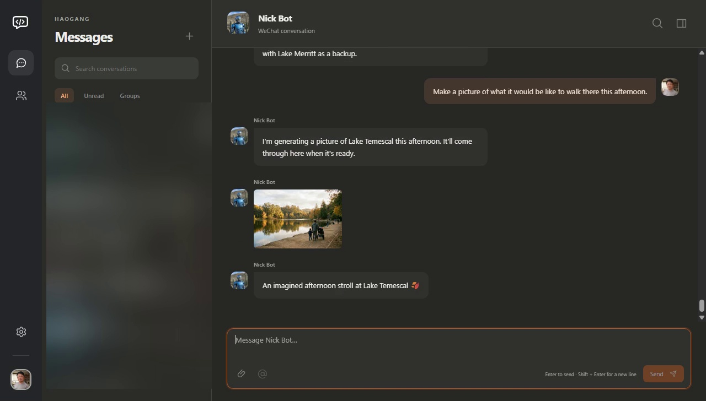
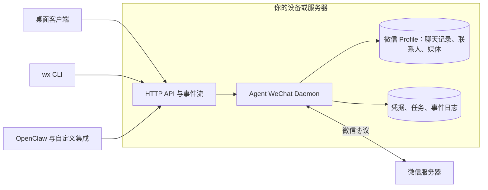

# Agent WeChat

[English](README.md) | 简体中文

**面向人与 AI 智能体的开源微信客户端。**

使用另一款微信桌面客户端、直接在终端中操作，或连接你的 AI 智能体。你可以查看会话、交换媒体文件，并基于同一套 API 构建自己的工具。Agent WeChat 直接与微信通信；其 Daemon 无需官方应用保持运行。

[快速上手](#快速上手) · [文档](https://thisnick.github.io/agent-wechat/zh-cn/) · [OpenClaw](#openclaw) · [下载](https://github.com/thisnick/agent-wechat/releases)

## 效果演示

https://github.com/user-attachments/assets/969f95ef-c17a-4e22-bda0-ec9e08af4ad3

[观看 93 秒演示视频](https://www.youtube.com/watch?v=T5LgL4n1MOQ) ·
[下载演示视频](docs/public/demo/agent-wechat-demo.mp4)

这是与 Nick Bot 的一段对话：在手机上提问、收到语音回复，在桌面客户端中请求生成图片，然后在终端中保存结果。录屏展示的是本次演示所用的构建版本；当前的安装配置与平台状态请见下方链接。

### 桌面端界面



### 微信语音通话

https://github.com/user-attachments/assets/764bc53f-cea2-4b3e-99a1-34fdcb43ec09

## 快速上手

### 桌面端应用

1. 从 [GitHub Releases](https://github.com/thisnick/agent-wechat/releases) 下载适用于你所用平台的安装包。
2. 选择 **使用此设备** 以运行本地 Hub，或选择 **连接到其他 Hub**。
3. 添加微信 Profile，并按照手机上的提示完成登录。

应用内置聊天界面、原生 Hub 以及 `wx` CLI。安装包、系统要求、连接密钥和网络配置，请参阅[桌面端指南](https://thisnick.github.io/agent-wechat/zh-cn/setup/desktop/)。各平台的桌面端打包与安装后的验收情况有所不同；请根据你所用的版本，查看[平台验收状态](PLATFORM-ACCEPTANCE.md)和发布说明。

### 终端与 API

使用 npm 安装原生 CLI，然后启动其 Daemon：

```bash
npm install -g @agent-wechat/cli
wx --json version
wx serve
```

请允许该软件包的安装脚本运行，以便下载并校验原生可执行文件。[其他安装方式](https://thisnick.github.io/agent-wechat/zh-cn/setup/install/)包括 pnpm、独立二进制文件和 Docker。如需进行语音和视频预处理，请在运行 Daemon 的主机上安装 FFmpeg 与 FFprobe；桌面应用已内置这两个组件。

如果你已有受支持的 **Linux 版微信** 官方 Profile，请先关闭官方应用并备份其文件，然后在另一个终端中运行：

```bash
wx auth login --official
wx accounts list
wx chats list
wx messages list filehelper --limit 5
```

Daemon 使用该 Profile 期间，请保持官方应用关闭。如需创建独立的新 Profile，请参阅[连接你的账号](https://thisnick.github.io/agent-wechat/zh-cn/setup/connect/)。新 Profile 不会获取你完整的旧聊天记录。如果有多个账号，请使用 `--account ID_OR_ALIAS` 选择其中一个。

连接成功后，即可查看会话并保存附件：

```bash
wx contacts find Alice
wx messages list CHAT_ID --limit 20
wx messages media CHAT_ID MESSAGE_ID --output ./saved-image.jpg
```

更多内容请参阅 [CLI 示例](https://thisnick.github.io/agent-wechat/zh-cn/use/cli/)、[API 文档](https://thisnick.github.io/agent-wechat/zh-cn/use/api/)和[部署方式](https://thisnick.github.io/agent-wechat/zh-cn/setup/run/)。

## 微信功能支持

| 领域 | 支持能力 |
| --- | --- |
| 会话 | 支持私聊与群聊；浏览和搜索本地保存的历史记录；查看未读数，并将会话标为已读。 |
| 消息 | 收发文本、图片、视频、文件和语音消息；撤回符合条件的自己发送的消息，并显示收到的撤回通知。 |
| 图片与视频 | 预览并下载可用的画质版本，包括原图和原始视频；发送普通画质或原始画质的视频。 |
| 语音消息 | 播放收到的语音消息，并将音频发送为原生语音消息。较长的音频可以拆分为多条语音消息；较长语音消息的播放验证仍不完整。 |
| 语音通话 | 在插件中启用语音通话功能后，可通过 [`wx calls` CLI](https://thisnick.github.io/agent-wechat/zh-cn/reference/calls/) 或 [OpenClaw 插件](https://thisnick.github.io/agent-wechat/zh-cn/openclaw/calling/) 拨打和接听微信一对一语音通话。桌面端语音通话即将推出。 |
| 富文本内容 | 查看引用消息、链接卡片元数据和合并转发的聊天记录。合并转发会转换为文本；其中嵌套的附件保留为占位符。 |
| 表情 | 获取受支持的普通表情和共享表情，包括动态原图。暂不支持发送表情或管理表情包。 |
| @ 提醒 | 发送真实的群成员 @ 提醒，或在允许的情况下 @所有人；解析收到消息中的 @ 提醒元数据。 |
| 联系人与群聊 | 查找联系人和群聊，读取群成员列表和头像，并刷新已保存的元数据。 |
| 群管理 | 在账号权限允许的范围内，创建、重命名和退出群聊，添加或移除成员，设置你在群内的昵称，清空群公告，以及设置消息免打扰。部分资料更新仍为局部更新。 |
| 会话管理 | 置顶或取消置顶受支持的会话；开启或关闭普通联系人和群聊的消息免打扰。 |
| 媒体存储 | 为每个账号配置自动下载，保存已校验的媒体文件，并查看传输进度和媒体不可用状态。 |
| 桌面端 | 会话搜索、媒体查看、引用消息跳转、@ 选择器、系统原生文件保存、托盘行为和系统通知。平台验收状态见上文。 |
| 自动化 | 使用 `wx` CLI 或经身份验证的 HTTP API；跟随可重放的事件流，并查看发送和下载任务。 |

媒体的可用性取决于接收来源、支持的格式和大小限制。搜索仅覆盖已保存的历史记录，不包含远端的全部历史。详见[消息类型](https://thisnick.github.io/agent-wechat/zh-cn/how-it-works/message-types/)、[媒体](https://thisnick.github.io/agent-wechat/zh-cn/use/media/)和[群聊](https://thisnick.github.io/agent-wechat/zh-cn/use/groups/)。

## 使用现有的官方 Profile

Agent WeChat 可以**直接**读取现有的 Linux 版微信官方 Profile（无需迁移），并继续执行受支持的写入操作。它保留账号身份，并使用其中已保存的会话、联系人、群聊和媒体。

| Profile 数据 | 读取 | 写入 |
| --- | --- | --- |
| 消息 | 已保存的历史记录及受支持的富文本内容 | 新收到的消息和已被接受的外发消息；受支持的撤回更新 |
| 联系人 | 已保存的联系人元数据和头像 | 通过微信同步接收的受支持元数据 |
| 群聊 | 群详情、成员列表、群名称和消息免打扰设置 | 受支持的同步字段和群操作结果；部分更新仍为局部更新 |
| 媒体 | 受支持的已缓存图片、视频、文件和语音消息 | 受支持的已下载或已发送缓存文件，以及对应的资源记录 |
| 会话状态 | 会话列表、未读状态、受支持的置顶和免打扰设置 | 受支持的已读状态、置顶和消息提醒更新 |
| 登录信息 | 受支持的已保存账号和设备信息（在微信接受的情况下） | 受支持的、已被接受的登录与路由信息更新 |

离线 Profile 命令可以在不启动 Daemon、不连接网络的情况下，借助保留源文件的快照和所需密钥，检视受支持的历史记录、联系人、群聊和媒体。这里的联系人写入仅指同步的元数据，并不代表支持任意添加、删除或编辑好友。

现有 Profile 的兼容性面向已识别的 Linux 版微信数据布局。未识别的文件会被保留，不受支持的数据库结构会被拒绝。官方搜索索引的通用维护、任意 Profile 迁移以及无缝切换回官方应用，目前尚未得到验证。复制、导入和导出流程仍属实验性功能。详见[原生 Profile 指南](packages/native-client-rust/README.md)。

## OpenClaw

使用 `@agent-wechat/agent-wechat` 插件将 AI 智能体接入微信：

```bash
openclaw plugins install @agent-wechat/agent-wechat
```

然后按照 [OpenClaw 配置指南](https://thisnick.github.io/agent-wechat/zh-cn/openclaw/setup/)选择账号、创建限定范围的 API 令牌，并设置智能体回复的对象。在完成配置之前，私聊和群聊均处于禁用状态。回复将使用已连接的微信账号发送。

| 功能 | 支持情况 |
| --- | --- |
| 私聊与群聊 | 接收允许的消息，并在同一微信会话中回复。 |
| 多模态输入 | 支持兼容视觉模型的图片；本地文件、视频和语音附件；通过 OpenClaw 已配置的运行时进行语音转写。 |
| 多模态输出 | 文本、图片、视频、文件和原生语音消息。普通音频可以保留为文件。 |
| 群聊上下文与 @ 提醒 | 按群设置行为；真实 @ 提醒触发；允许的未 @ 消息作为上下文；外发的成员 @ 提醒和 @所有人。 |
| 访问策略 | 私聊和群聊分别设置策略；发送者白名单；按群覆盖设置。 |
| 当前会话工具 | `wechat_history`、`wechat_search`、`wechat_message` 和 `wechat_media`，用于查询已保存的历史记录并获取已校验的附件。 |
| 可选的归档访问 | 当智能体工具策略授予权限时，`wechat_archive_*` 工具可以列出、搜索和读取账号内的所有会话。 |
| 消息操作 | `wechat_recall`；通过 `message.replyTo` 进行引用回复；通过 `wechat_send_share` 发送链接卡片。 |
| 登录辅助 | `wechat_login` 可以查看登录状态、显示登录二维码、等待手机确认、断开连接、退出登录，或明确清除本地认证信息。 |
| 群信息 | `wechat_group_info` 在群主或管理员授权范围内，读取已缓存的群聊和群成员信息。不提供修改群信息的工具。 |
| 已读行为 | 可设置为在入站消息处理后、模型确认分发后标记已读，或从不标记。该操作会通过已读边界作用于整个会话。 |
| 托管与恢复 | 可使用外部 Daemon，或由插件托管；重启后保留事件进度；状态不确定的发送会报告以供人工审核，绝不会被盲目重发。 |

默认的历史记录和媒体工具仅限于当前会话。归档权限允许读取账号内的所有会话（包括来自其他渠道的会话），因此只应授予确实需要该访问范围的智能体。多模态理解与生成取决于你配置的模型和工具。详见[智能体工具](https://thisnick.github.io/agent-wechat/zh-cn/openclaw/tools/)、[访问策略](https://thisnick.github.io/agent-wechat/zh-cn/openclaw/access/)和[托管模式](https://thisnick.github.io/agent-wechat/zh-cn/openclaw/modes/)。

## 工作原理



Rust 编写的 Daemon 负责账号、同步和媒体处理。各客户端共享经过身份验证的 API 和事件流。受支持的消息、联系人和群聊状态保存在微信 Profile 中；Daemon 则单独保存凭据、待处理工作和恢复记录。每个 Profile 由唯一的写入者独占。

桌面应用、CLI 和 OpenClaw 使用的同一套 API，同样可用于你自己的脚本、集成和客户端。请阅读[架构指南](https://thisnick.github.io/agent-wechat/zh-cn/how-it-works/architecture/)，了解各组件的边界与存储模型。

从旧版本升级？请按照[迁移指南](https://thisnick.github.io/agent-wechat/zh-cn/setup/migrate/)操作，并保留你的 Profile 和备份。

## 体验与贡献

无需连接微信，即可使用模拟账号和媒体体验客户端：

```bash
pnpm install --frozen-lockfile
pnpm client:dev
```

前置条件与场景控制，请参阅[客户端预览指南](packages/client-ui/README.md)和[模拟器指南](packages/native-client-rust/crates/wechat-simulator/README.md)。如需构建并测试改动，请先阅读 [AGENTS.md](AGENTS.md) 和[构建指南](https://thisnick.github.io/agent-wechat/zh-cn/reference/build/)。

[演示素材与画廊源码](scripts/demo-gallery/README.md)包含成片视频、截图、合成的视觉测试素材和图片生成脚本。[视频剪辑源码](scripts/demo-video/README.md)保留了动态标题、时间轴和原创配乐；私有的原始录屏不纳入 Git 仓库。

## 许可证

Agent WeChat 的原创项目代码采用 [MIT 许可证](LICENSE)。第三方组件保留其原有的许可证和声明；请查阅[随附声明](packages/cli/THIRD_PARTY_NOTICES.txt)、各组件的独立声明，以及 [Inter 字体许可证](scripts/demo-video/fonts/OFL.txt)。
