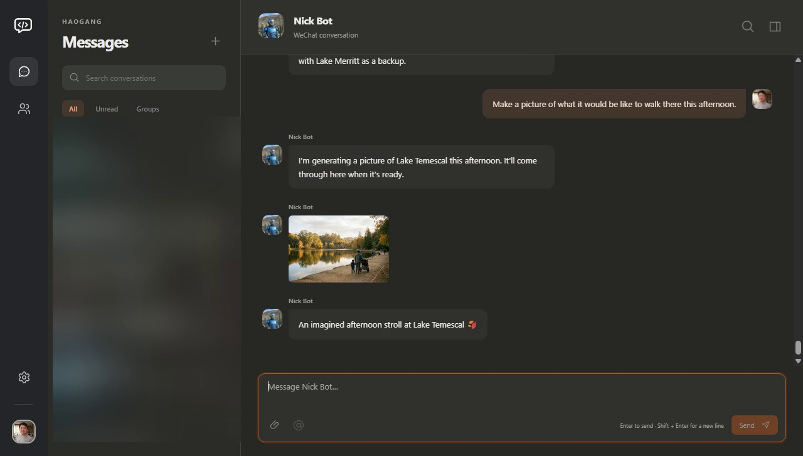
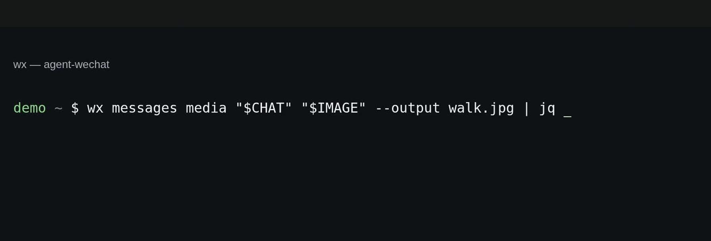
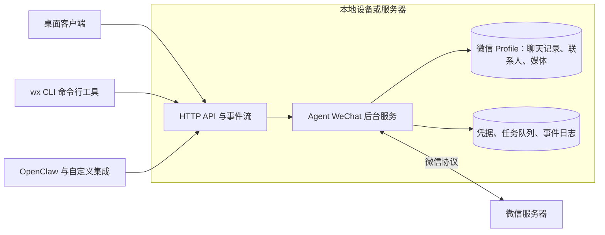

# Agent WeChat

[English](README.md) | [简体中文](README.zh-CN.md)

**面向人类与 AI 智能体的开源微信客户端。**

使用全新的微信桌面客户端、直接在终端中进行操作，或连接你的 AI 智能体。基于同一套 API，你可以查看会话、收发媒体文件，并构建专属工具。Agent WeChat 直接与微信底层协议通信；其后台服务（Daemon）无需依赖官方客户端运行。

[快速上手](#快速上手) · [文档](https://thisnick.github.io/agent-wechat/zh-cn/) · [OpenClaw](#openclaw) · [下载](https://github.com/thisnick/agent-wechat/releases)

## 效果演示

https://github.com/user-attachments/assets/969f95ef-c17a-4e22-bda0-ec9e08af4ad3

[观看 93 秒演示视频](https://www.youtube.com/watch?v=T5LgL4n1MOQ) ·
[下载演示视频](docs/public/demo/agent-wechat-demo.mp4)

与 Nick Bot 的一次完整对话流程：手机发送提问、接收语音回复、在桌面客户端中请求生成图片，并在终端中保存生成结果。录屏展示了演示所使用的构建版本；当前安装配置与平台状态请见下方链接。

### 桌面端界面



### 在终端中使用微信



## 快速上手

### 桌面端应用

1. 从 [GitHub Releases](https://github.com/thisnick/agent-wechat/releases) 下载适用于你平台的安装包。
2. 选择**“使用此设备” (Use this device)** 运行本地 Hub，或选择**“连接到其他 Hub” (Connect to another hub)**。
3. 添加微信 Profile 并按照手机上的提示完成登录。

应用已内置聊天界面、原生 Hub 服务以及 `wx` CLI。有关安装包、系统要求、连接密钥与网络配置，请参阅[桌面端指南](https://thisnick.github.io/agent-wechat/zh-cn/setup/desktop/)。不同平台的打包与系统验收状态有所不同；详情请查阅[平台验收状态](PLATFORM-ACCEPTANCE.md)及对应版本的发布说明。

### 终端与 API

使用 npm 安装原生 CLI，然后启动后台 Daemon 服务：

```bash
npm install -g @agent-wechat/cli
wx --json version
wx serve
```

请允许该 npm 包的安装脚本执行（`allow-scripts`），以便下载并校验原生可执行文件。[其他安装方式](https://thisnick.github.io/agent-wechat/zh-cn/setup/install/)包括 pnpm、独立二进制文件以及 Docker。如需处理语音/视频，请在 Daemon 宿主机上安装 FFmpeg 和 FFprobe；桌面端应用已内置这两个依赖。

如果你已有受支持的 **Linux 微信官方客户端** Profile 数据，请先关闭官方应用并备份其数据文件，然后在另一个终端中执行：

```bash
wx auth login --official
wx accounts list
wx chats list
wx messages list filehelper --limit 5
```

当 Daemon 使用该 Profile 时，请保持官方客户端关闭。如需创建独立的全新 Profile，请参阅[连接你的账号](https://thisnick.github.io/agent-wechat/zh-cn/setup/connect/)。新 Profile 不会同步完整的历史聊天记录。如果配置了多个账号，可通过 `--account ID_OR_ALIAS` 指定操作目标。

连接成功后，即可查看会话并保存附件：

```bash
wx contacts find Alice
wx messages list CHAT_ID --limit 20
wx messages media CHAT_ID MESSAGE_ID --output ./saved-image.jpg
```

更多信息请参阅 [CLI 命令示例](https://thisnick.github.io/agent-wechat/zh-cn/use/cli/)、[API 文档](https://thisnick.github.io/agent-wechat/zh-cn/use/api/)以及[部署托管方式](https://thisnick.github.io/agent-wechat/zh-cn/setup/run/)。

## 微信功能支持

| 领域 | 支持能力 |
| --- | --- |
| 会话 | 支持单聊与群聊；浏览和搜索本地存储的历史记录；查看未读计数并将聊天标记为已读。 |
| 消息 | 收发文本、图片、视频、文件以及语音消息；撤回自身符合条件的消息并显示接收到的撤回通知。 |
| 图片与视频 | 预览并下载可用画质版本（包含原图/原视频）；发送普通或原始画质视频。 |
| 语音 | 播放接收到的语音消息，并将音频编码为原生语音条发送。较长音频可分段为多条语音；长语音条的接收端播放验证尚不完整。 |
| 富文本内容 | 查看引用回复、分享链接卡片元数据以及合并转发的聊天记录。合并转发会转为文本呈现；其嵌套的附件保留为占位符。 |
| 表情 | 获取受支持的普通/共享表情（包括动态原图）。暂不支持主动发送表情和管理表情包。 |
| 提醒 (@) | 发送真实的群成员 @提醒 或全员 @所有人（需对应权限）；解析接收消息中的 @提醒元数据。 |
| 联系人与群聊 | 查找联系人/群聊，获取成员列表与头像，并刷新已保存的元数据。 |
| 群聊管理 | 建群、改名、退群、添加/移除群成员、修改自己在群内的昵称、清空群公告以及设置消息免打扰（视账号权限而定）。部分 Profile 同步更新仍为局部更新。 |
| 会话管理 | 置顶/取消置顶受支持的聊天，开启/关闭普通联系人与群聊的消息免打扰。 |
| 媒体存储 | 按账号配置自动下载规则，保存校验通过的媒体文件，查看传输进度及媒体不可用状态。 |
| 桌面端 | 会话搜索、媒体查看、引用消息跳转定位、@选择器、系统原生文件保存、托盘行为以及系统通知。平台验收状态参见上文。 |
| 自动化 | 使用 `wx` CLI 或经过身份验证的 HTTP API；订阅可重放的事件流并监控发送/下载任务。 |

发送引用回复与链接卡片已实现，但仍待接收端实机验证。媒体文件的可用性取决于接收来源、受支持格式及体积上限。搜索仅覆盖本地已保存的历史记录，而非远端全部云端历史。详见[消息类型](https://thisnick.github.io/agent-wechat/zh-cn/how-it-works/message-types/)、[媒体文件](https://thisnick.github.io/agent-wechat/zh-cn/use/media/)、[群聊管理](https://thisnick.github.io/agent-wechat/zh-cn/use/groups/)以及[已实现功能与验证清单](packages/native-client-rust/FEATURES.md)。

## 直接使用现有的官方 Profile

Agent WeChat 可以**就地 (in place)** 读取现有的 Linux 微信官方 Profile 数据并继续执行受支持的写入操作。它保留账号身份，直接使用已有的本地会话、联系人、群聊与媒体记录。

| Profile 数据 | 读取 | 写入 |
| --- | --- | --- |
| 消息 | 已存储的聊天记录及受支持的富文本内容 | 新接收的消息及已被接受的外发消息；受支持的撤回状态更新 |
| 联系人 | 已保存的联系人元数据与头像 | 通过微信同步协议接收到的受支持元数据 |
| 群聊 | 群详情、成员名单、群名及消息提醒设置 | 受支持的同步字段及群操作执行结果；部分更新仍为局部更新 |
| 媒体 | 受支持的已缓存图片、视频、文件及语音 | 受支持的下载/发送缓存文件及对应的资源表记录 |
| 会话状态 | 会话列表、未读状态、受支持的置顶与免打扰设置 | 受支持的已读状态、置顶与消息提醒设置更新 |
| 登录凭据 | 当微信服务器接受时，使用受支持的已存账号/设备信息 | 受支持的已确认登录凭据与路由信息更新 |

离线 Profile 相关命令支持在不启动 Daemon、不连接网络的情况下，借助保持源文件原样的快照与对应密钥，直接检视已存储的历史消息、联系人、群聊及媒体。此处的联系人写入指协议同步的元数据，并不代表支持任意好友的添加、删除或编辑。

现有 Profile 兼容性针对已识别的 Linux 微信数据布局。未识别的文件会被保留，不受支持的数据库结构会被拒绝处理。官方全文搜索索引维护、任意 Profile 结构迁移以及无缝切回官方客户端等场景尚未建立验证。复制/导入/导出工作流目前仍处于实验阶段。详见[原生 Profile 指南](packages/native-client-rust/README.md)。

## OpenClaw

使用 `@agent-wechat/agent-wechat` 插件将 AI 智能体接入微信：

```bash
openclaw plugins install @agent-wechat/agent-wechat
```

然后按照 [OpenClaw 配置指南](https://thisnick.github.io/agent-wechat/zh-cn/openclaw/setup/)选择对应账号、创建限定权限的令牌，并配置智能体响应的目标受众。私聊和群聊在显式配置前默认禁用。智能体会以当前已连接的微信账号进行回复。

| 特性 | 支持情况 |
| --- | --- |
| 私聊与群聊 | 接收受允许的消息，并在相同的微信对话中回复。 |
| 多模态输入 | 适用于兼容多模态视觉模型的图片；本地文件/视频/语音附件；通过 OpenClaw 配置的运行时实现语音转写。 |
| 多模态输出 | 支持输出文本、图片、视频、文件以及原生语音条。普通音频也可以保持为文件发送。 |
| 群聊上下文与 @提醒 | 支持按群定制策略、真实群成员 @提醒 触发、将未 @提醒 的允许消息作为上下文传入，以及外发成员/所有人 @提醒。 |
| 访问控制策略 | 独立的私聊/群聊访问策略、发送者白名单以及单群覆盖规则。 |
| 当前会话工具 | 提供 `wechat_history`、`wechat_search`、`wechat_message` 和 `wechat_media`，用于检索本地历史记录和获取校验后的附件。 |
| 可选归档访问权限 | 当智能体工具策略授权时，`wechat_archive_*` 工具可列出、搜索和读取该账号下的所有会话。 |
| 消息操作 | `wechat_recall`；通过 `message.replyTo` 进行引用回复以及通过 `wechat_send_share` 发送链接卡片受上述实机验证限制。 |
| 辅助登录 | `wechat_login` 工具支持查询登录状态、展示登录二维码、等待手机确认、断开连接、登出或显式清除本地认证信息。 |
| 群信息查询 | `wechat_group_info` 提供群主/管理员授权范围内的已缓存群聊及群成员信息查询。不提供修改群属性的工具。 |
| 已读行为策略 | 可配置为消息接收处理后标记已读、模型确认派发后标记已读，或从不标记已读。该操作通过已读游标作用于整场会话。 |
| 托管与故障恢复 | 支持外部独立 Daemon 或由插件自动托管；跨进程重启保留事件进度；状态不确定的发送操作将上报待人工审核，绝不盲目重复发送。 |

默认的历史记录与媒体工具仅作用于当前聊天。归档权限（Archive）允许读取全账号的所有会话（包括来自其他渠道的会话），因此请仅将其授予确实需要该范围权限的智能体。多模态理解与生成依赖于你配置的大模型与工具。详见[智能体工具](https://thisnick.github.io/agent-wechat/zh-cn/openclaw/tools/)、[访问策略](https://thisnick.github.io/agent-wechat/zh-cn/openclaw/access/)以及[托管运行模式](https://thisnick.github.io/agent-wechat/zh-cn/openclaw/modes/)。

## 工作原理



Rust 编写的后台 Daemon 服务负责账号会话、协议同步与媒体传输。各客户端共享同一个经过身份认证的 API 与事件流。受支持的消息/联系人/群聊状态直接保存在微信 Profile 中；Daemon 则将凭据、待处理任务与故障恢复记录独立存储。每个 Profile 保持单一写入者独占。

桌面端应用、CLI 和 OpenClaw 所使用的这套 API 同样对你的自建脚本、集成工具和客户端开放。组件边界与数据存储模型的详细说明，请参阅[系统架构指南](https://thisnick.github.io/agent-wechat/zh-cn/how-it-works/architecture/)。

从旧版本升级？请按照[版本迁移指南](https://thisnick.github.io/agent-wechat/zh-cn/setup/migrate/)操作，并注意保留现有的 Profile 和备份。

## 体验与贡献

无需连接微信，即可使用虚拟合成账号与媒体数据体验客户端：

```bash
pnpm install --frozen-lockfile
pnpm client:dev
```

前置准备与场景控制请参阅[客户端预览指南](packages/client-ui/README.md)以及[模拟器指南](packages/native-client-rust/crates/wechat-simulator/README.md)。如需构建代码并运行测试，请查阅 [AGENTS.md](AGENTS.md) 与[构建指南](https://thisnick.github.io/agent-wechat/zh-cn/reference/build/)。

[演示资源与画廊源码](scripts/demo-gallery/README.md)包含已完成的视频、截图、合成视觉资产及图片生成脚本。[视频剪辑工程源码](scripts/demo-video/README.md)保留了动效字幕、节奏剪辑与原创配乐；私有录屏原片不纳入 Git 仓库。

## 开源协议

Agent WeChat 原创项目代码采用 [MIT 许可证](LICENSE) 开源。第三方组件保留其原有许可证与版权声明；详见[附带声明](packages/cli/THIRD_PARTY_NOTICES.txt)、组件独立声明以及 [Inter 字体许可证](scripts/demo-video/fonts/OFL.txt)。
