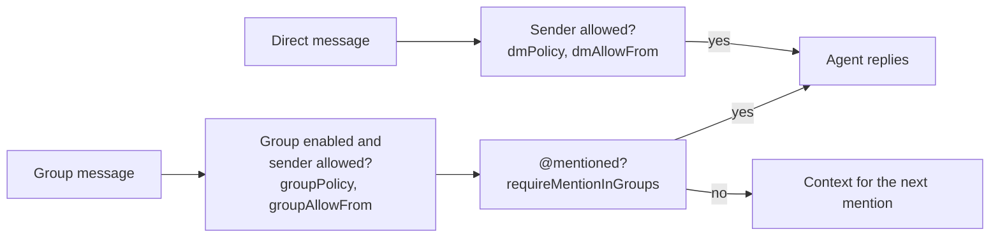

import { Aside } from '@astrojs/starlight/components';

Every incoming message passes these checks before the agent sees it. Nothing
gets through by default.



A message that fails a check is ignored. Media in an ignored message is never
downloaded and no model run starts for it.

## Direct messages

| `dmPolicy` | Who gets a reply |
| --- | --- |
| `disabled` (default) | Nobody |
| `allowlist` | Senders listed in `dmAllowFrom` |
| `open` | Anyone who messages you |

## Groups

| `groupPolicy` | Who gets a reply in groups |
| --- | --- |
| `disabled` (default) | Nobody |
| `allowlist` | Groups listed in `groupAllowFrom` (and, if set, senders in `groupSenderAllowFrom`) |

In groups, the agent only replies when someone **@mentions** you by default.
`requireMentionInGroups` is `true` by default; setting it to `false` lets the
agent answer every admitted group message.

```yaml
dmPolicy: allowlist
dmAllowFrom:
  - wxid_alice
  - wxid_bob
groupPolicy: allowlist
groupAllowFrom:
  - family@chatroom
  - project@chatroom
groupSenderAllowFrom:
  - wxid_carol
requireMentionInGroups: true
```

Here the agent answers Alice and Bob directly. In the two listed groups it
answers only when mentioned; `groupSenderAllowFrom` further narrows which group
senders are admitted. Every other group is ignored.

The `*` wildcard is accepted in the allow-from lists.

## Messages that arrive while the channel is off

| Missed message | What happens |
| --- | --- |
| Sent in the last 24 hours | Answered, if it passes the checks above |
| More than `historyLimit` (default 50) | Only the newest are answered |
| Older than 24 hours | Skipped |

The event journal has its own retention window on the daemon; the bridge
recovers the newest retained cursor on reconnect and skips stale history.
Skipped messages are noted in the host log.

<Aside title="Good to know">
- **Find IDs** with `wx contacts find NAME` for people and `wx chats find NAME`
  for groups (group IDs end in `@chatroom`). Your own ID is the `senderId` on
  messages you sent.
- **A mention means a real WeChat @mention** of your account or everyone in the
  group. The daemon reads WeChat's mention metadata; typing "@yourname" as
  plain text doesn't count.
- **Recalled messages** are removed from the context.
- **Media is checked after the sender.** Attachments from ignored messages are
  never downloaded or transcribed.
- **Voice messages in chat are annotated, not transcribed.** A voice message is
  described by trusted metadata; chat transcription is not available. Call-time
  speech is a separate, opt-in feature — see [calling](/deepseek-harness/calling/).
</Aside>
