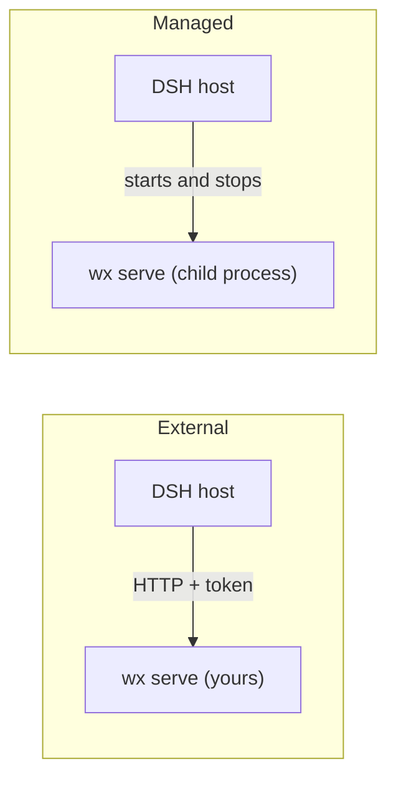

import { Aside } from '@astrojs/starlight/components';



| | External | Managed |
| --- | --- | --- |
| Who runs `wx serve` | You: the desktop app, `wx daemon`, systemd or Docker | DSH, as a child process |
| Where it can run | Anywhere the host can reach | Same machine as the host |
| `wx` needed on the host | No | Yes |
| Host stops or crashes | Daemon keeps running | Daemon stops |
| Use it when | You also use the CLI, or the desktop app manages the hub | You want one process to manage |

**External** is the default choice. The [quick setup](/deepseek-harness/setup/)
uses it — for example the hub managed by the AgentWechat desktop app on
`http://127.0.0.1:6174`.

## Managed mode

Stop any other daemon that uses the same data folder, then set the `native`
block:

```yaml
native:
  mode: managed
  accountId: ACCOUNT_ID
  dataDir: /home/you/.local/share/agent-wechat
  executable: /path/to/wx        # optional; otherwise found on PATH
  tokenCredentialRef: WECHAT_DAEMON_TOKEN
```

Log in to the account [with the CLI](/setup/connect/) before switching to
managed mode; the plugin doesn't log in for you.

<Aside title="Good to know">
- **Managed mode doesn't restart a crashed daemon.** The host reports the
  failure; restart the host to recover.
- **It won't take over a port that's already in use**, and it never stops a
  process it didn't start.
- **External mode never stops or logs out** the daemon. Stopping the plugin only
  closes its connection.
- **For a remote daemon**, use HTTPS or a tunnel. The daemon normally listens
  on localhost.
- One plugin instance serves one WeChat account.
</Aside>
