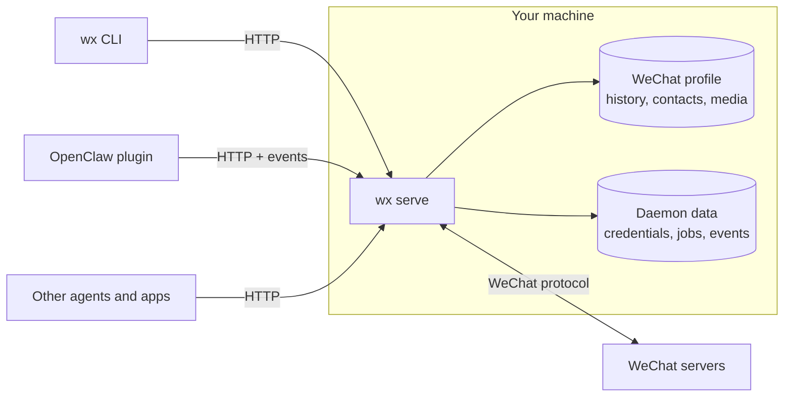

import { Aside } from '@astrojs/starlight/components';

`wx serve` speaks WeChat's own protocol, like the desktop app does. No WeChat app, screen or browser runs anywhere.

**Your WeChat profile stays the main store.** History, contacts and media are kept in the same encrypted format WeChat for Linux uses, either in a profile the daemon created or in an existing one used with `--official`. Messages the daemon sends or receives are written there as if the app had handled them.

**The daemon keeps its own data separately:** login credentials, queued sends and downloads, the event log, and anything the profile has no place for.

**Every client uses the same HTTP API.** The CLI is a thin client for it. The OpenClaw plugin follows the event stream and calls the same routes, and so can any other agent plugin or app. See [HTTP API](/use/api/).

## Inside the daemon

| Part | Job |
| --- | --- |
| Account worker | One per account: holds the connection to WeChat, keeps the login alive, and runs one change at a time |
| Sync | Receives new messages through a push connection, falling back to polling if the connection drops |
| Profile reader/writer | Reads history through a small pool of consistent snapshots; keeps one writer for supported database layouts |
| Job queue | Runs sends, downloads, recalls and read notices, and remembers them across restarts |
| Event log | Records every committed change so clients can replay what they missed |
| HTTP server | Serves `/v1`, checks tokens and scopes, streams events |

For an owned profile using SQLite's WAL journal mode, the worker briefly pauses
writes to capture each request's database and event position. It then releases
the writer while the request reads and formats its results. Up to four reads
per account can run together, with eight across the daemon. Profiles using
other journal modes keep serialized reads; the daemon does not change their
journal mode.

Downloads have a separate limit: two per account and four across the daemon.
Network waits release the account writer, which checks the login and job state
again before saving a result. Sends keep their existing queue. Discovering and
registering saved media still uses the writer.

The Rust crates in [`packages/native-client-rust`](https://github.com/thisnick/agent-wechat/tree/main/packages/native-client-rust) follow the same split: `wechat-protocol`, `wechat-profile`, `wechat-store`, `wechat-core`, `wechat-api` and the `wx` binary.

For direct library use, see [Rust libraries](/reference/rust-libraries/).

<Aside title="Good to know">
- **One daemon can host several accounts**, each with its own worker, login and event log.
- **Unknown data is kept, not guessed at.** If WeChat sends something the daemon doesn't understand, it's stored and not written to the profile, so nothing is lost or corrupted.
- **One writer per profile.** The daemon takes a lock so two daemons can't share a profile, but it can't stop the WeChat app being opened.
</Aside>
