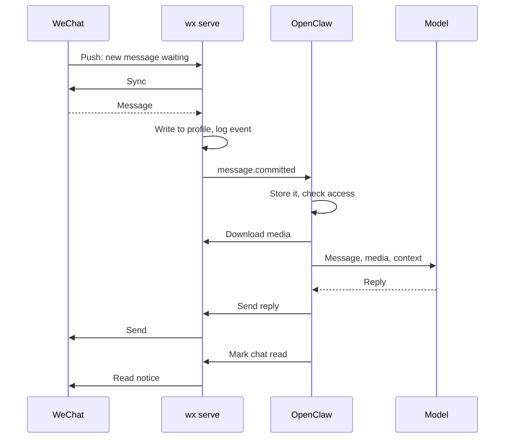

import { Aside } from '@astrojs/starlight/components';

1. **WeChat signals new data.** The daemon keeps a push connection open. The signal says only that something is waiting, so the daemon then syncs to fetch it.
2. **The daemon commits it.** The message is written to your profile, then recorded as a `message.committed` event. Clients only hear about messages that are safely stored.
3. **OpenClaw takes it.** The plugin saves the event before acknowledging it, so a crash can't lose or duplicate it. Then it runs the [access checks](/openclaw/access/).
4. **Media is fetched only if allowed.** Images, files, video and voice are downloaded, checked against their size and hash, and handed to OpenClaw. Voice can be transcribed.
5. **The agent replies.** The reply is a normal [send](/how-it-works/sends/), with a key that prevents duplicates.
6. **The chat is marked read** according to the [read policy](/openclaw/read-receipts/), and WeChat is told so your other devices can follow.

<Aside title="Good to know">
- **If the push connection drops,** the daemon polls until it reconnects. `wx account status` shows which one is in use (`incomingTransport`).
- **Old messages don't trigger replies.** When the daemon connects, it first catches up on anything that arrived while it was offline. Those messages, imported history and your own outgoing messages are stored but never sent to the agent. Only messages that arrive after that are.
- **Media can lag.** If an attachment isn't downloadable yet, OpenClaw holds the message and leaves it unread until it is.
- **Recalls are events too.** When someone recalls a message, OpenClaw drops it from pending work, and the stored copy becomes "[Message recalled]".
</Aside>
