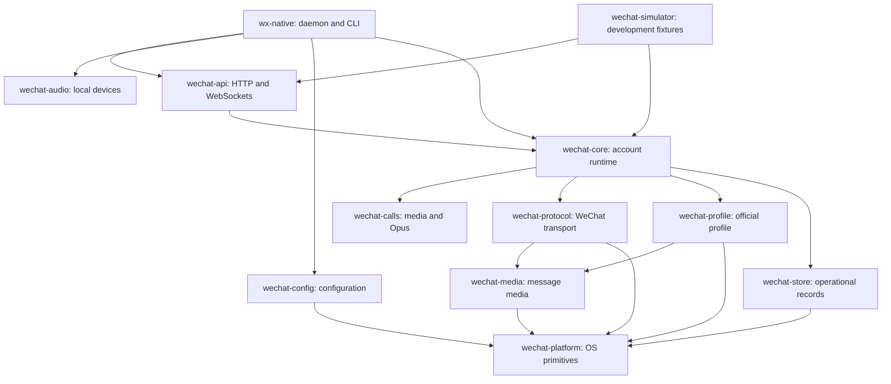

The Rust workspace separates WeChat transport, official-profile access, account
orchestration and client adapters. Four libraries are published; the daemon,
CLI and supporting runtime crates remain internal.

## Package dependencies

Arrows below mean “depends on.” `wechat-protocol` does **not** depend on
`wechat-calls`, `wechat-audio` or `wechat-profile`.

Utility dependencies are omitted. The CLI and API also use `wechat-calls`
for PCM framing.

| Package | Responsibility | Published crate? |
| --- | --- | --- |
| `wechat-platform` | OS/file primitives | Yes |
| `wechat-media` | Message image/media inspection | Yes |
| `wechat-profile` | Supported official profile readers and writers | Yes |
| `wechat-protocol` | WeChat requests, signaling and encrypted transport | Yes |
| `wechat-calls` | PCM frames, pacing, queues and optional Opus codec | No |
| `wechat-audio` | Microphone/speaker adapter and resampling | No |
| `wechat-core` | Account authorization, ownership, call state and workers | No |
| `wechat-api` | HTTP routes, authenticated control/media sockets and contracts | No |
| `wechat-store` | Pending operations and recovery receipts | No |
| `wechat-config` | CLI/daemon configuration files | No |
| `wechat-simulator` | Synthetic backend and development fixtures | No |
| `wx-native` | `wx` executable, daemon startup and CLI participation | No |

Canonical chat state stays in the official profile. Operational call records
do not create another history database. The four public crates remain unchanged.
[Reusable Rust libraries](../../reference/rust-libraries/) describes their standalone APIs.

## Media adapters

Outgoing client PCM passes through the API, Core's call worker, `wechat-calls`
encoding and `wechat-protocol` transport. Incoming media follows the reverse
path. Negotiation belongs in the worker/transport layers, not the device adapter.

| Dependency | Where and why |
| --- | --- |
| `opusic-c = 1.6.1` | Optional `wechat-calls/native-opus`; uses libopus for audio encoding/decoding |
| `rubato` | `wechat-audio` resampling between device and call formats |
| `libpulse-binding` | Linux capture/playback |
| `coreaudio-rs` / `coreaudio-sys` | macOS capture/playback, including VoiceProcessingIO |
| `wasapi` | Windows capture/playback |

`wechat-audio` is our internal adaptation of sys-voice and the acpfx fork, with
upstream licensing and source pins retained in its
[provenance file](https://github.com/thisnick/agent-wechat/blob/main/packages/native-client-rust/crates/wechat-audio/THIRD-PARTY.md).
Device setup does not establish measured acoustic echo-cancellation quality.

The private TypeScript HTTP/WebSocket SDK and OpenClaw extension talk to the
daemon; neither needs libopus or OS audio bindings in Node. The Rust daemon still
has native dependencies. A standalone JavaScript WeChat transport is not provided.

## Building

[Build from source](../../reference/build/) covers workspace builds and optional
features. [Calling](../../reference/calls/) describes daemon, CLI and OpenClaw use;
[Calls API](../../reference/calls-api/) owns call payloads and events.
