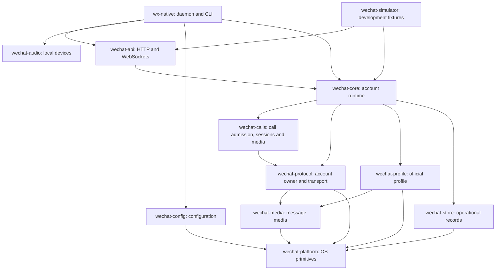

The Rust workspace separates WeChat transport, official-profile access, account
orchestration and client adapters. Five libraries are published; the daemon,
CLI and remaining runtime crates stay internal.

## Package dependencies

Arrows below mean “depends on.” `wechat-protocol` does **not** depend on
`wechat-calls`, `wechat-audio` or `wechat-profile`.

Utility dependencies are omitted. Core owns the daemon's internal PCM envelope;
the API and CLI reuse `wechat-calls` audio format types. Call sockets use JSON
with base64 PCM, while the daemon assembles and paces audio frames.

| Package | Responsibility | Published crate? |
| --- | --- | --- |
| `wechat-platform` | OS/file primitives | Yes |
| `wechat-media` | Message image/media inspection | Yes |
| `wechat-profile` | Supported official profile readers and writers | Yes |
| `wechat-protocol` | Account-owning `NativeClient`, authenticated requests, signaling and encrypted transport | Yes |
| `wechat-calls` | Per-account call admission, sessions, media workers, source tracking, PCM, pacing, mixing and Opus | Yes |
| `wechat-audio` | Microphone/speaker adapter and resampling | No |
| `wechat-core` | Daemon permissions, profile integration, operation journals and call orchestration | No |
| `wechat-api` | HTTP routes, authenticated control/media sockets and contracts | No |
| `wechat-store` | Pending operations and recovery receipts | No |
| `wechat-config` | CLI/daemon configuration files | No |
| `wechat-simulator` | Synthetic backend and development fixtures | No |
| `wx-native` | `wx` executable, daemon startup and CLI participation | No |

`NativeClient` owns account state and the authenticated request lifecycle.
Cloning a client shares that account rather than creating another mutable copy.
Core uses the same client and keeps daemon permissions and operation journals.

Call admission in `wechat-calls` decides which controller owns a call attempt
and whether a request is new, duplicated or stale. Core uses that same state
machine. An unresolved submission keeps the account's call slot reserved until
cleanup; a timeout alone does not authorize another invitation.

Canonical chat state stays in the official profile. Operational call records
do not create another history database. Call sessions consume the protocol
crate's codecs and account-owned transport.
[Reusable Rust libraries](../../reference/rust-libraries/) describes their standalone APIs.

## Media adapters

Outgoing client PCM passes through the API and Core adapter into `wechat-calls`
media workers. Those workers handle pacing and Opus with `wechat-protocol`
packet codecs. Incoming media follows the reverse path. Core supplies daemon
permissions, interruption checks and event delivery; the calls crate has no
Core, HTTP, persistence or device dependency.

| Dependency | Where and why |
| --- | --- |
| `opusic-c = 1.6.1` | Included in native `wechat-calls` builds; uses libopus for audio encoding/decoding |
| `rubato` | `wechat-audio` resampling between device and call formats |
| `libpulse-binding` | Linux capture/playback |
| `coreaudio-rs` / `coreaudio-sys` | macOS capture/playback, including VoiceProcessingIO |
| `wasapi` | Windows capture/playback |

`wechat-audio` is our internal adaptation of sys-voice and the acpfx fork, with
upstream licensing and source pins retained in its
[provenance file](https://github.com/thisnick/agent-wechat/blob/main/packages/native-client-rust/crates/wechat-audio/THIRD-PARTY.md).
Device setup does not establish measured acoustic echo-cancellation quality.

The private TypeScript HTTP/WebSocket SDK and OpenClaw extension talk to the
daemon; neither needs libopus or OS audio bindings in Node. The Rust daemon still
has native dependencies. A standalone JavaScript WeChat transport is not provided.

## Building

[Build from source](../../reference/build/) covers workspace builds and platform
prerequisites. [Calling](../../reference/calls/) describes daemon, CLI and OpenClaw use;
[Calls API](../../reference/calls-api/) owns call payloads and events.
