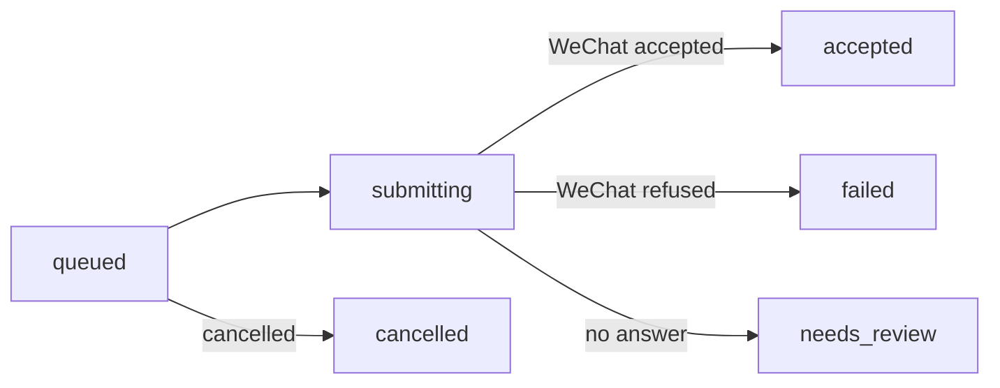

import { Aside } from '@astrojs/starlight/components';

A send can fail in an awkward way: WeChat accepts the message, but the reply never comes back. Sending again would duplicate it. So every send carries an **idempotency key**, and an unknown outcome is reported as unknown instead of being retried.



| State | Meaning | What to do |
| --- | --- | --- |
| `accepted` | WeChat took the message | Nothing. (It doesn't confirm the recipient's phone got it.) |
| `failed` | WeChat refused it | Fix the cause and send again with a **new** key |
| `needs_review` | Unknown: it may or may not have gone out | Check the chat. Don't resend automatically. |
| `cancelled` | Stopped before it was submitted | Nothing |

## Same key, same send

The CLI saves a receipt with the key before it sends anything. If the connection drops, look the send up instead of sending again:

```bash
wx messages sends lookup --idempotency-key order-1234-confirmation
wx jobs get JOB_ID
```

Sending again with the same key and the same content returns the original send. The same key with different content is rejected.

## After a restart

Queued sends, downloads, read notices, the event log and the login all survive a restart. Work that was mid-flight when the daemon stopped comes back as `needs_review` rather than being repeated.

Stopping the daemon (or disconnecting) doesn't log you out. Only `wx auth logout` does, and after that the daemon won't reconnect on its own until you log in again.

<Aside title="Good to know">
- **Voice notes are split** into 10-second parts. A partial result keeps the IDs of the parts that went out.
- **Closing the connection doesn't cancel anything.** Ctrl-C on the CLI or a dropped HTTP request leaves the daemon's work running.
- **Media writeback repair:** if a sent or downloaded file didn't make it into the profile's own folders, `wx jobs repair-writeback` finishes the job from files the daemon already has. It never downloads or sends anything.
- **Don't delete files to force a fresh login.** You can lose saved device trust, database keys or pending receipts.
</Aside>
