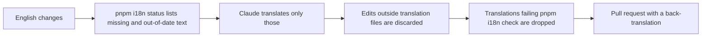

import { Aside } from '@astrojs/starlight/components';

When English text changes, a bot translates the new and changed text into every
language with Claude and opens a pull request for review:

| English changed in | Translations arrive in |
| --- | --- |
| Your pull request | `i18n/pr-<number>`, a pull request based on your branch |
| main (a fork's pull request, a direct push) | `i18n/sync`, a pull request based on main |

1. Read the bot's pull request. It ends with a back-translation into English, so
   you can review a language you don't read.
2. Merge it into your branch, then merge your branch.

The bot can only change translation files, and it drops any translation that
fails `pnpm i18n check`, so that text stays in English. Docs pages it wrote show a
"translated by machine" banner until someone reviews the page and removes
`banner` from its frontmatter.

## What the bot does

Each translation records which version of the English it was made from, so the bot
only translates what is new or changed and leaves the rest alone. To fix or add a
translation yourself, see [Translate](/reference/translate/).

<Aside title="Good to know">
- The bot skips drafts and pull requests from forks; their English is translated
  after it reaches main. It rebuilds its pull request whenever the English changes
  again, so merge it before editing it.
- Pull requests the bot opens don't start CI on their own. The bot runs
  `pnpm i18n check` before publishing, and CI runs on your branch once you merge.
- The bot uses Claude Haiku and follows the language's glossary in
  `docs/i18n/glossary/`. It runs in `.github/workflows/i18n-translate.yml`.
</Aside>
