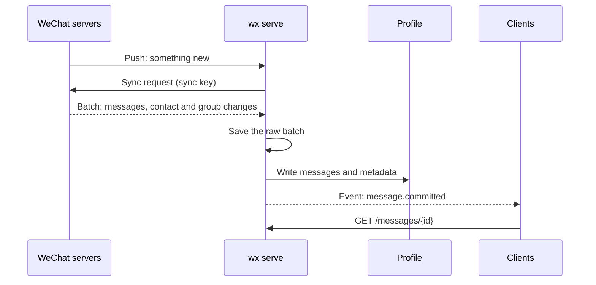
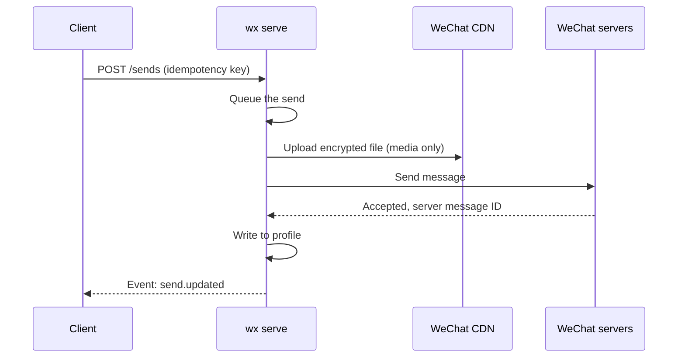

import { Aside } from '@astrojs/starlight/components';

`wx serve` connects to WeChat's servers the way a WeChat desktop client does: as a logged-in device on your account. Everything else is built on four exchanges.

## 1. Staying logged in

At login, WeChat issues credentials tied to a device identity, which the daemon stores (encrypted) in its data folder. While connected, the daemon sends the heartbeats WeChat asks for and renews the session when it expires. After a restart it reconnects with the saved credentials; it never starts a new QR login by itself. If WeChat rejects the session, `wx auth login` asks you to approve again.

## 2. Receiving

1. The daemon keeps a push connection open. A push only says that something changed; it carries no content.
2. The daemon asks for everything since its last **sync key**. WeChat returns a batch of changes and a new key.
3. The raw batch is saved first, so nothing is lost if writing fails halfway.
4. The changes are written to the profile: new messages, unread counts, contacts and groups.
5. Only then does each new message become a `message.committed` event. Clients follow the [event stream](/use/api/#receive), fetch the message, and acknowledge how far they've read.

If the push connection drops, the daemon polls instead until it's back (`incomingTransport` in `wx account status`). Anything that arrived while the daemon was offline comes in a catch-up batch when it reconnects. It's stored, but marked as catch-up so clients don't treat it as new.

## 3. Sending

Text goes straight to WeChat. Media is first prepared (images checked, video and audio converted with FFmpeg, voice encoded to WeChat's SILK format), encrypted, uploaded to WeChat's CDN and read back. Only then is the message that points to it sent. Every send has an idempotency key, so a retry never sends twice. See [Sends and recovery](/how-it-works/sends/).

## 4. Media and read state

**Downloads.** A received image, file, video or voice message only references an encrypted file on WeChat's CDN. When a client asks for it, the daemon downloads it, decrypts it, checks its size and hash, and caches it in the profile. Cached files keep working after WeChat's copy expires.

**Read state.** Marking a chat read clears its unread count in the profile and sends WeChat a read notice, so your phone and other devices can clear it too. Reading history doesn't do this; only an explicit read does.

## Clients

Clients only see the HTTP API and events. Each decides what to do with a message:

- The **CLI** prints events (`wx events watch`) and lets you reply.
- **OpenClaw** checks who sent it, downloads media, runs the agent, replies and marks the chat read. See [Who the bot answers](/openclaw/access/) and [Read receipts](/openclaw/read-receipts/).
- **Your own code** can do the same through the [HTTP API](/use/api/).

<Aside title="Good to know">
- **Changes the daemon doesn't understand are kept, not skipped.** They stay saved and hold back the sync checkpoint, so nothing is silently lost.
- **Recalls arrive as changes too.** The stored message becomes "[Message recalled]" and a `message.recalled` event goes out.
- **Your phone stays in charge.** The daemon is one more logged-in device; messages it sends show up on your phone like any other device's.
</Aside>
