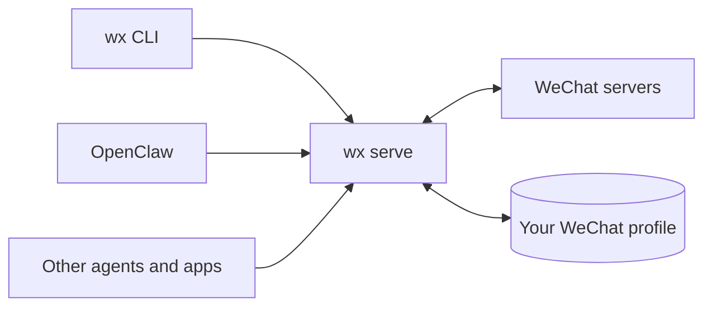

import { Card, CardGrid } from '@astrojs/starlight/components';



`wx serve` talks to WeChat directly; no WeChat app or desktop runs. It keeps using your existing WeChat profile, so your history stays where it is. Every client goes through its HTTP API: the `wx` CLI, the OpenClaw plugin, and anything you build. A native desktop app is on the way.

```bash
npm install -g @agent-wechat/cli@beta
wx serve                          # terminal 1
wx auth login --official          # terminal 2: approve on your phone or scan the QR
wx messages list filehelper
```

<CardGrid>
  <Card title="Set it up" icon="rocket">
    Install, log in, run it in the background, or move from the old container. [What you need →](/setup/requirements/)
  </Card>
  <Card title="Use it" icon="puzzle">
    From the CLI, as an OpenClaw channel, or from your own agent or app. [CLI recipes →](/use/cli/)
  </Card>
  <Card title="See how it works" icon="information">
    The daemon, the message flow, sends and where your data lives. [Architecture →](/how-it-works/architecture/)
  </Card>
</CardGrid>
