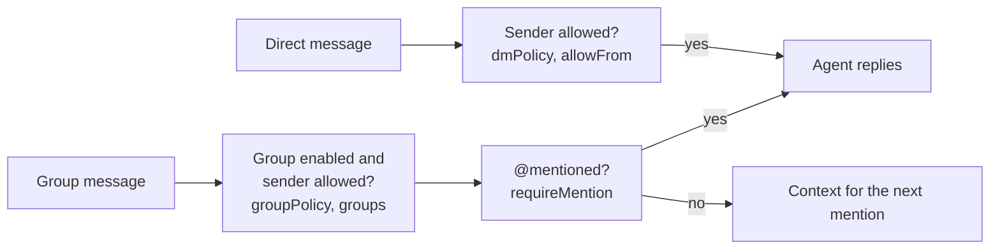

import { Aside } from '@astrojs/starlight/components';

Every incoming message passes these checks before the agent sees it. Nothing gets through by default.



A message that fails a check is ignored and stays unread.

## Direct messages

| `dmPolicy` | Who gets a reply |
| --- | --- |
| `disabled` (default) | Nobody |
| `allowlist` | Senders listed in `allowFrom` |
| `open` | Anyone who messages you |

## Groups

| `groupPolicy` | Who gets a reply in groups |
| --- | --- |
| `disabled` (default) | Nobody |
| `allowlist` | Senders in `groupAllowFrom`, or in `allowFrom` if that's empty |
| `open` | Any group member |

In groups, the agent only replies when someone **@mentions** you. The next mention includes the messages since the agent's last reply in that group as context, read from the chat's history.

Override any of this per group in `groups`, keyed by group ID, with `"*"` for all groups:

```json
"agent-wechat": {
  "dmPolicy": "allowlist",
  "allowFrom": ["wxid_alice", "wxid_bob"],
  "groupPolicy": "allowlist",
  "groups": {
    "*": { "enabled": false },
    "family@chatroom": { "enabled": true, "requireMention": false },
    "project@chatroom": { "enabled": true, "allowFrom": ["wxid_carol"] }
  }
}
```

Here the agent answers Alice and Bob directly. In the family group it answers Alice and Bob without needing a mention. In the project group it answers only Carol, when she mentions you. Every other group is ignored.

## Messages that arrive while OpenClaw is off

When the Gateway starts again, the agent catches up on what it missed:

| Missed message | What happens |
| --- | --- |
| Sent in the last 24 hours | Answered, if it passes the checks above |
| More than 100 of those | Only the newest 100 are answered |
| Older than 24 hours | Skipped |

Only messages that pass the checks above count toward the 100, including any that were waiting when the Gateway stopped. Group messages without a mention still appear as context for the next mention. Skipped messages are noted in the Gateway log.

<Aside title="Good to know">
- **Find IDs** with `wx contacts find NAME` for people and `wx chats find NAME` for groups (group IDs end in `@chatroom`). Your own ID is the `senderId` on messages you sent.
- **A mention means a real WeChat @mention** of your account or everyone in the group. The daemon reads WeChat's mention metadata; typing "@yourname" as plain text doesn't count. See [sending and receiving mentions](/use/groups/#mention-group-members).
- **Group context:** `messages.groupChat.historyLimit` sets how many earlier messages a mention can include (default 50, maximum 200, 0 turns it off). It includes only messages from people the agent may answer, never your own. Images in that context are downloaded only when a mention triggers a reply.
- **Recalled messages** are removed from the context, even if they were never answered.
- **Media is checked after the sender.** Attachments from ignored messages are never downloaded or transcribed.
</Aside>
