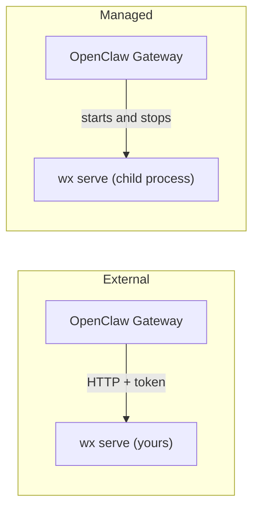

import { Aside } from '@astrojs/starlight/components';



| | External | Managed |
| --- | --- | --- |
| Who runs `wx serve` | You: `wx daemon`, systemd or Docker | OpenClaw, as a child process |
| Where it can run | Anywhere the Gateway can reach | Same machine as the Gateway |
| `wx` needed on the Gateway host | No | Yes |
| Gateway stops | Daemon keeps running | Daemon stops |
| Use it when | You also use the CLI, or run the daemon in Docker | You want one process to manage |

**External** is the default choice. The [quick setup](/openclaw/setup/) uses it.

## Managed mode

Stop any other daemon that uses the same data folder, then replace the `native` block:

```json
"native": {
  "mode": "managed",
  "accountId": "ACCOUNT_ID",
  "dataDir": "/home/you/.local/share/agent-wechat",
  "listen": "127.0.0.1:6174",
  "token": { "source": "env", "provider": "default", "id": "AGENT_WECHAT_TOKEN" },
  "consumerStateDir": "/home/you/.openclaw/agent-wechat"
}
```

OpenClaw finds `wx` on `PATH`, or set `executable` to its full path. Log in to the account [with the CLI](/setup/connect/) before switching to managed mode; the plugin doesn't log in for you.

<Aside title="Good to know">
- **Managed mode doesn't restart a crashed daemon.** The Gateway reports the failure; restart the Gateway to recover.
- **It won't take over a port that's already in use**, and it never stops a process it didn't start.
- **The token is passed to the child over a pipe**, not as a file, argument or environment variable. A `serverConfig` used with managed mode must not set `tokenFile`.
- **External mode never stops or logs out** the daemon. Stopping the Gateway only closes its connection.
- **For a remote daemon**, use HTTPS or a tunnel. The daemon only listens on localhost.
- One OpenClaw channel uses one WeChat account.
</Aside>
