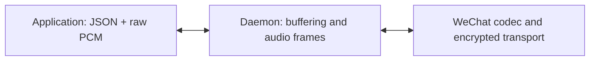

Send and receive **raw PCM16 little-endian samples** on the media WebSocket.
Binary messages contain audio only. JSON text messages carry attachment,
format and stream information. There is no custom binary header or WAV container.
The daemon handles audio framing, pacing, codecs and WeChat transport.



## Attach and exchange audio

1. Claim a call through the [control API](../calls-api/) and wait for
   `call.state` with `state: "connected"`. Keep the owning control socket open.
2. Open `/v1/accounts/{account}/calls/{callId}/media` with the same account's
   `calls` bearer authorization header. Within five seconds, send this JSON:

   ```json
   {
     "type": "media.attach",
     "clientId": "example-client",
     "ownerToken": "<secret owner token>"
   }
   ```

3. Wait for this JSON response on the **media** socket. Direction is relative
   to your application; use the announced format and generation.

   ```json
   {
     "type": "media.ready",
     "sendTrack": {
       "id": 1,
       "generation": 1,
       "direction": "send",
       "format": {
         "sampleRate": 16000,
         "channels": 1,
         "frameMs": 20
       }
     },
     "receiveTrack": {
       "id": 2,
       "generation": 1,
       "direction": "receive",
       "format": {
         "sampleRate": 16000,
         "channels": 1,
         "frameMs": 20
       }
     }
   }
   ```

4. Start the outgoing stream with a JSON text message, then send binary PCM:

   ```json
   {
     "type": "audio.start",
     "generation": 1
   }
   ```

   Binary bytes `00 80 ff 7f ff ff` represent three samples: `-32768`, `32767`,
   and `-1`. They contain no track ID, counter or length prefix. The same byte
   layout applies in both directions.

| Property | Current value |
| --- | --- |
| Sample encoding | Signed 16-bit, little-endian |
| Sample rate / channels | 16,000 Hz / mono |
| Daemon audio frame duration | 20 ms: 320 samples / 640 bytes |
| Application chunk size | Any nonempty whole-sample chunk, up to 64 KiB |
| Daemon outgoing queue | At most eight seconds |

Your chunks do not need to be 20 ms long. The daemon combines smaller chunks,
splits larger ones, and clocks complete frames. Consume incoming binary messages
as PCM chunks; do not depend on their boundaries. This API does not offer
sample-rate or codec-bitrate controls.

## Direct Node.js example

Install the third-party WebSocket library used here:

```bash
npm install ws
```

agent-wechat exposes HTTP/WebSocket APIs; its internal TypeScript adapter is
not published as a standalone SDK. This example uses `ws` directly.

Keep your owning **control** socket open. Set
`WX_CLIENT_ID` from its `hello` event, and `WX_CALL_ID` / `WX_OWNER_TOKEN` from
its successful dial or answer result. `WX_ACCOUNT_ID`, `WX_TOKEN` and
`WX_BASE_URL` identify the same daemon/account used for control.

```js
import WebSocket from "ws";

const {
  WX_BASE_URL = "http://127.0.0.1:6174",
  WX_ACCOUNT_ID,
  WX_TOKEN,
  WX_CALL_ID,
  WX_CLIENT_ID,
  WX_OWNER_TOKEN,
} = process.env;

if (![WX_ACCOUNT_ID, WX_TOKEN, WX_CALL_ID, WX_CLIENT_ID, WX_OWNER_TOKEN].every(Boolean)) {
  throw new Error("Set the account, bearer token and values from your owning control socket");
}

const url = new URL(WX_BASE_URL);
url.protocol = url.protocol === "https:" ? "wss:" : "ws:";
url.pathname = `/v1/accounts/${encodeURIComponent(WX_ACCOUNT_ID)}/calls/${encodeURIComponent(WX_CALL_ID)}/media`;
const media = new WebSocket(url, {
  headers: { Authorization: `Bearer ${WX_TOKEN}` },
});

media.on("open", () => {
  media.send(JSON.stringify({
    type: "media.attach",
    clientId: WX_CLIENT_ID,
    ownerToken: WX_OWNER_TOKEN,
  }));
});

media.on("message", (data, isBinary) => {
  if (isBinary) {
    // With ws's default binary type, data is a Buffer of raw PCM16 LE.
    console.log("Received PCM bytes:", data.length);
    return;
  }

  const event = JSON.parse(data.toString());
  if (event.type === "media.ready") {
    // These track fields come from the daemon's JSON response.
    const { sendTrack } = event;
    media.send(JSON.stringify({
      type: "audio.start",
      generation: sendTrack.generation,
    }));
    // Send 20 ms of silence. Replace this Buffer with your PCM sample bytes.
    media.send(Buffer.alloc(640));
  } else if (event.type === "call.error") {
    console.error("Media rejected:", event.code);
    media.close();
  }
});

media.on("error", () => {
  console.error("Media connection failed");
});
```

`media.on` and `media.send` are `ws` methods. `sendTrack` and `receiveTrack`
are JSON fields in the daemon's `media.ready` response.

## Media endpoint payloads

| Direction | WebSocket message | Payload |
| --- | --- | --- |
| Client → daemon | First text message | `media.attach`: `clientId`, `ownerToken` |
| Daemon → client | Text response | `media.ready`: `sendTrack`, `receiveTrack`, each with ID, generation, direction and format |
| Client → daemon | Text before outgoing PCM | `audio.start`: `generation` |
| Either direction | Binary | Raw PCM16 little-endian samples only |
| Daemon → client | Text on attachment failure | `call.error`: `code` |

The complete attachment, ready and start JSON examples are shown in
[Attach and exchange audio](#attach-and-exchange-audio). `audio.start` has no
separate acknowledgement; subsequent binary messages on that socket belong to
its generation. Receiving PCM does not require starting an outgoing stream.
An attachment failure can return:

```json
{
  "type": "call.error",
  "code": "not_owner"
}
```

## Mute and interrupt

Send these JSON commands on the **control** socket:

```json
{
  "type": "call.mute",
  "requestId": "mute-1",
  "callId": "example-call",
  "muted": true
}
```

```json
{
  "type": "call.clear_audio",
  "requestId": "interrupt-1",
  "callId": "example-call"
}
```

Muting silences outgoing audio. Clearing discards queued outgoing audio and
advances its generation. The **control** socket reports:

```json
{
  "type": "track.updated",
  "callId": "example-call",
  "track": {
    "id": 1,
    "generation": 2,
    "direction": "send",
    "format": {
      "sampleRate": 16000,
      "channels": 1,
      "frameMs": 20
    }
  }
}
```

Wait for this update and the successful command result, discard interrupted
producer output, then send this JSON on the **media** socket before fresh PCM:

```json
{
  "type": "audio.start",
  "generation": 2
}
```

Subsequent binary chunks belong to that stream. Already-transmitted
old-generation chunks are discarded. The receive track is unchanged.

Stop audio at `ending`, `ended`, `uncertain`, lost ownership or authorization.
Keep control connected during `ending` until terminal confirmation.

:::note[Good to know]
No microphone, speaker or native codec dependency is required in Node. Your
WebSocket library must support authorization headers; a browser's bare
WebSocket constructor cannot supply them. Use HTTPS/WSS or a trusted tunnel for
remote access. Never log owner tokens. Odd-byte chunks, invalid stream setup,
queue overflow and lost authorization close the media connection.
:::
