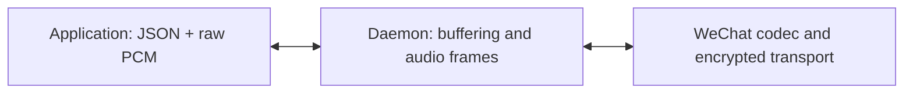

Send and receive **raw PCM16 little-endian samples** on the media WebSocket.
Binary messages contain audio only. JSON text messages carry attachment,
format and stream information. There is no custom binary header or WAV container.
The daemon handles audio framing, pacing, codecs and WeChat transport.



## Attach and exchange audio

1. Claim a call through the [control API](../calls-api/) and wait for
   `call.state` with `state: "connected"`. Keep the owning control socket open.
2. Open `/v1/accounts/{account}/calls/{callId}/media` with the same account's
   `calls` bearer authorization header. Within five seconds, send this JSON:

   ```json
   {"type":"media.attach","clientId":"example-client","ownerToken":"<secret owner token>"}
   ```

3. Wait for this JSON response on the **media** socket. Direction is relative
   to your application; use the announced format and generation.

   ```json
   {
     "type":"media.ready",
     "sendTrack":{"id":1,"generation":1,"direction":"send","format":{"sampleRate":16000,"channels":1,"frameMs":20}},
     "receiveTrack":{"id":2,"generation":1,"direction":"receive","format":{"sampleRate":16000,"channels":1,"frameMs":20}}
   }
   ```

4. Start the outgoing stream with a JSON text message, then send binary PCM:

   ```json
   {"type":"audio.start","generation":1}
   ```

   Binary bytes `00 80 ff 7f ff ff` represent three samples: `-32768`, `32767`,
   and `-1`. They contain no track ID, counter or length prefix. The same byte
   layout applies in both directions.

| Property | Current value |
| --- | --- |
| Sample encoding | Signed 16-bit, little-endian |
| Sample rate / channels | 16,000 Hz / mono |
| Daemon audio frame duration | 20 ms: 320 samples / 640 bytes |
| Application chunk size | Any nonempty whole-sample chunk, up to 64 KiB |
| Daemon outgoing queue | At most eight seconds |

Your chunks do not need to be 20 ms long. The daemon combines smaller chunks,
splits larger ones, and clocks complete frames. Consume incoming binary messages
as PCM chunks; do not depend on their boundaries. This API does not offer
sample-rate or codec-bitrate controls.

## TypeScript example

The repository's SDK sends `audio.start` automatically when a producer first
writes a generation. Capture the generation for that producer; old producers
must not adopt a new one after an interruption.

```ts
const media = await calls.attachMedia(callId);
const generation = media.tracks().sendTrack.generation;
media.sendPcm(new Int16Array([1000, -1000, 0]), generation);

for await (const chunk of media.frames()) {
  consumePcm16LittleEndian(chunk.payload);
}
```

## Mute and interrupt

Send these JSON commands on the **control** socket:

```json
{"type":"call.mute","requestId":"mute-1","callId":"example-call","muted":true}
```

```json
{"type":"call.clear_audio","requestId":"interrupt-1","callId":"example-call"}
```

Muting silences outgoing audio. Clearing discards queued outgoing audio and
advances its generation. Wait for `track.updated` and the successful command
result, discard interrupted producer output, then send `audio.start` with the
new generation on the media socket. Subsequent binary chunks belong to that
stream. Already-transmitted old-generation chunks are discarded. The receive
track is unchanged.

Stop audio at `ending`, `ended`, `uncertain`, lost ownership or authorization.
Keep control connected during `ending` until terminal confirmation.

:::note[Good to know]
No microphone, speaker or native codec dependency is required in Node. Your
WebSocket factory must support authorization headers; a browser's bare
WebSocket constructor cannot supply them. Use HTTPS/WSS or a trusted tunnel for
remote access. Never log owner tokens. Odd-byte chunks, invalid stream setup,
queue overflow and lost authorization close the media connection.
:::
