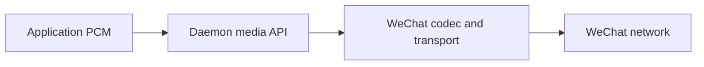

Use the media WebSocket after claiming a call through the [control API](../calls-api/).
Your application sends and receives PCM samples. The daemon handles WeChat's
codec, packet framing, authentication and encryption; those packets and keys
are never part of this API.



The repository's TypeScript SDK handles API framing through `attachMedia`,
`sendPcm` and `frames`. Direct WebSocket clients use the message layout below.

## Attach

1. Keep the owning control socket connected. Open
   `/v1/accounts/{account}/calls/{callId}/media` with the same account's `calls`
   bearer authorization header.
2. Within five seconds, send this first text message using the control socket's
   `clientId` and the secret `ownerToken` returned by its successful claim:

   ```json
   {"type":"media.attach","clientId":"example-client","ownerToken":"<secret owner token>"}
   ```

3. Wait for `media.ready` on that media socket:

   ```json
   {
     "type":"media.ready",
     "sendTrack":{"id":1,"generation":1,"direction":"send","format":{"sampleRate":16000,"channels":1,"frameMs":20}},
     "receiveTrack":{"id":2,"generation":1,"direction":"receive","format":{"sampleRate":16000,"channels":1,"frameMs":20}}
   }
   ```

4. Send one binary WebSocket message per audio frame on `sendTrack`; consume
   received messages on `receiveTrack`. Track direction is relative to your client.
   Use the announced IDs and format rather than assuming the example IDs.

## API binary message layout

This is the client-to-daemon API format. Its track IDs, generations and
sequences are independent of WeChat packet counters. Each message starts with
a 36-byte header. Header integers use unsigned big-endian
encoding; the audio payload uses signed PCM16 little-endian samples.

| Offset | Bytes | Meaning |
| --- | --- | --- |
| 0 | 4 | ASCII `WXCM` |
| 4 | 1 | Frame version, `1` |
| 5 | 1 | Payload kind, `1` for PCM16 |
| 6 | 2 | Reserved, both zero |
| 8 | 4 | Track ID, positive u32 |
| 12 | 4 | Track generation, positive u32 |
| 16 | 8 | Sequence, u64 |
| 24 | 8 | Monotonic stream timestamp in microseconds, u64 |
| 32 | 4 | Payload byte length, u32 |
| 36 | remaining | Exactly one announced PCM frame |

For 16 kHz mono with 20 ms frames, each payload has 320 samples / 640 bytes;
the complete message is 676 bytes. Increase the sequence for every frame.
Timestamps describe stream time, not wall-clock time. JavaScript clients should
use `bigint` for both 64-bit fields. The SDK encodes these without JSON conversion.
Malformed, replayed, foreign-track or old-generation frames are rejected.
The complete binary message cannot exceed 64 KiB.

## Stop, mute and interrupt

Send these commands on the **control** socket:

```json
{"type":"call.mute","requestId":"mute-1","callId":"example-call","muted":true}
```

```json
{"type":"call.clear_audio","requestId":"interrupt-1","callId":"example-call"}
```

Muting controls outgoing audio. Clearing discards queued outgoing audio and
advances the send track's generation; `track.updated` announces it. Discard old
producer output, use the new generation and restart its sequence. Clearing does
not reset the receive track. Do not continue sending the old generation.

Stop transmitting on `ending`, `ended` or `uncertain`, lost ownership, revoked
authorization or socket closure. During `ending`, keep control connected until
the terminal event arrives. A successful hangup command alone does not prove
that remote cleanup finished.

:::note[Good to know]
The TypeScript SDK handles control, framing and PCM queues without microphone,
speaker or native codec bindings. Your application supplies/consumes PCM and its
WebSocket factory must support authorization headers. A browser's bare WebSocket
constructor cannot supply those headers. Use HTTPS/WSS or a trusted tunnel for
remote connections, and never log owner tokens or complete claim results.
:::
