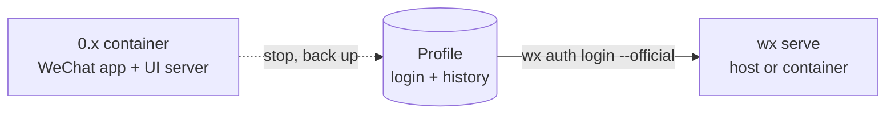

import { Aside, Steps, Tabs, TabItem } from '@astrojs/starlight/components';

Version 0.x ran the WeChat Linux app inside a Docker container and drove its UI. The native daemon talks to WeChat directly, and can keep using the same profile files, so you keep your login and history.



<Steps>

1. **Find the profile.** It's the container's home directory: a bind mount or a named volume.

   ```bash
   docker inspect OLD_CONTAINER --format '{{json .Mounts}}'
   ```

2. **Stop the old container and back up the profile.** Wait for any sends in progress to finish first. Keep the old container and its volumes; don't delete them.

   ```bash
   docker stop OLD_CONTAINER
   # named volume:
   docker run --rm -v OLD_VOLUME:/src:ro -v "$PWD":/out busybox \
     tar -czf /out/wechat-profile-backup.tgz -C /src .
   # bind mount:
   tar -czf wechat-profile-backup.tgz -C /path/to/old/bind-mount .
   ```

3. **Point the native daemon at the profile.**

   <Tabs>
   <TabItem label="Daemon on the host">

   [Install `wx`](/setup/install/), then run `wx serve` and, in a second terminal:

   ```bash
   wx auth login --official=/path/to/old/bind-mount
   ```

   For a named volume, copy its contents to a folder on the host first, or use the container option.

   </TabItem>
   <TabItem label="Daemon in a container">

   Set up the [Compose example](/setup/run/#docker-compose), then mount the old volume instead of a host folder:

   ```yaml
   services:
     agent-wechat-native:
       volumes:
         - old-home:/profiles/wechat
   volumes:
     old-home:
       external: true
       name: YOUR_OLD_VOLUME
   ```

   ```bash
   wx --server-name box auth login --official=/profiles/wechat
   ```

   </TabItem>
   </Tabs>

4. **Check history and contacts** before changing anything else.

   ```bash
   wx accounts list
   wx messages list filehelper --limit 5
   ```

5. **Update OpenClaw**, if you use it. Replace the old `serverUrl` and `token` settings with a `native` block, as shown in [OpenClaw quick setup](/openclaw/setup/). Remove `serverUrl`, `token`, `pollIntervalMs` and `authPollIntervalMs`. Keep `dmPolicy`, `allowFrom` and `groups`, and check they still do what you want once the channel is running.

</Steps>

## What changed

| 0.x | 1.x |
| --- | --- |
| `wx up` / `wx down` start the container | `wx serve` or `wx daemon start` |
| API at `/api` | API at `/v1`, with different routes and IDs. See [HTTP API](/use/api/). |
| OpenClaw `serverUrl` + `token` | OpenClaw `native` block with a token reference |
| Screenshots, VNC, chat selection | Gone; the daemon has no UI |
| Wechaty puppet | Retired |
| Proxy settings | Not supported yet |

<Aside title="Good to know">
- **The account ID is new.** Use the ID from `wx accounts list`, not the old session ID.
- **The old `agent.db` isn't needed.** The daemon keeps its own state in a separate data folder.
- **Permissions:** the native container runs as UID 10001; your old profile may be owned by someone else. Grant access rather than recursively changing ownership.
- **Going back:** stop the daemon, then restore the backup you made in step 2 into the old container. Don't point the old app at files the daemon has written to.
</Aside>
