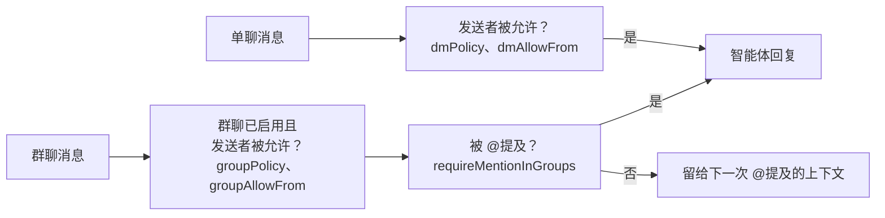

import { Aside } from '@astrojs/starlight/components';

每一条收到的消息在呈现给智能体之前，都要通过下面的检查。默认情况下没有任何消息能通过。



未通过检查的消息会被忽略。被忽略消息里的媒体永远不会被下载，也不会为它启动任何模型运行。

## 单聊

| `dmPolicy` | 谁会得到回复 |
| --- | --- |
| `disabled`（默认） | 任何人都不回复 |
| `allowlist` | `dmAllowFrom` 中列出的发送者 |
| `open` | 任何给你发消息的人 |

## 群聊

| `groupPolicy` | 群聊中谁会得到回复 |
| --- | --- |
| `disabled`（默认） | 任何人都不回复 |
| `allowlist` | `groupAllowFrom` 中列出的群（如果设置了 `groupSenderAllowFrom`，还要发送者在其中） |

群聊里，默认只有有人 **@提及**你时智能体才回复。`requireMentionInGroups` 默认为 `true`；设为 `false` 会让智能体回复每条准入的群消息。

```yaml
dmPolicy: allowlist
dmAllowFrom:
  - wxid_alice
  - wxid_bob
groupPolicy: allowlist
groupAllowFrom:
  - family@chatroom
  - project@chatroom
groupSenderAllowFrom:
  - wxid_carol
requireMentionInGroups: true
```

这里智能体会直接回复 Alice 和 Bob。在两个列出的群里，只有被提及时才回复；`groupSenderAllowFrom` 进一步限制哪些群发送者会被准入。其他所有群聊都会被忽略。

`*` 通配符在白名单里是被接受的。

## 通道关闭期间到达的消息

| 错过的消息 | 处理方式 |
| --- | --- |
| 最近 24 小时内发送的 | 如果通过上述检查，会被回复 |
| 多于 `historyLimit`（默认 50）条 | 只回复最新的那些 |
| 超过 24 小时 | 跳过 |

守护进程上的事件日志有自己的保留窗口；桥接器在重连时恢复最新的保留游标，并跳过陈旧历史。被跳过的消息会记在宿主日志里。

<Aside title="小提示">
- **查找 ID**：用 `wx contacts find NAME` 查联系人，用 `wx chats find NAME` 查群（群 ID 以 `@chatroom` 结尾）。你自己的 ID 是你发出的消息上的 `senderId`。
- **@提及指真正的微信 @提及**，即提及你的账号或群里的所有人。守护进程读取微信的提及元数据；把 "@你的名字" 当普通文本输入不算数。
- **被撤回的消息**会从上下文中移除。
- **媒体在发送者校验之后才处理。** 被忽略消息里的附件永远不会被下载或转写。
- **聊天中的语音消息只做标注，不转写。** 语音消息由可信元数据描述；聊天转写当前不可用。通话时的语音是另一项可选功能——参见[通话](/deepseek-harness/calling/)。
</Aside>
