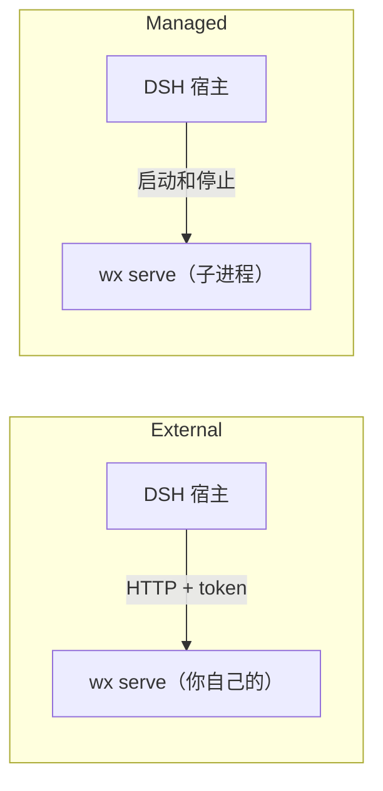

import { Aside } from '@astrojs/starlight/components';



| | 外部模式 | 托管模式 |
| --- | --- | --- |
| 谁运行 `wx serve` | 你：桌面应用、`wx daemon`、systemd 或 Docker | DSH，作为子进程 |
| 可以运行在哪里 | 宿主能访问的任何地方 | 与宿主同一台机器 |
| 宿主上是否需要 `wx` | 不需要 | 需要 |
| 宿主停止或崩溃时 | 守护进程继续运行 | 守护进程停止 |
| 适用场景 | 你也用 CLI，或桌面应用在管理 hub | 你希望由一个进程统一管理 |

**外部模式**是默认选择。[快速上手](/deepseek-harness/setup/) 用的就是它——例如由 AgentWechat 桌面应用管理的 hub（`http://127.0.0.1:6174`）。

## 托管模式

先停掉任何使用同一数据目录的守护进程，然后设置 `native` 配置块：

```yaml
native:
  mode: managed
  accountId: ACCOUNT_ID
  dataDir: /home/you/.local/share/agent-wechat
  executable: /path/to/wx        # 可选；否则从 PATH 中查找
  tokenCredentialRef: WECHAT_DAEMON_TOKEN
```

切换到托管模式之前，先用 [CLI 登录账号](/setup/connect/)；插件不会替你登录。

<Aside title="小提示">
- **托管模式不会重启崩溃的守护进程。** 宿主会报告失败；重启宿主即可恢复。
- **它不会接管已被占用的端口**，也绝不会停止不是它启动的进程。
- **外部模式绝不会停止或登出**守护进程。停止插件只是关闭它自己的连接。
- **对于远程守护进程**，使用 HTTPS 或隧道。守护进程通常只监听 localhost。
- 一个插件实例只服务一个微信账号。
</Aside>
