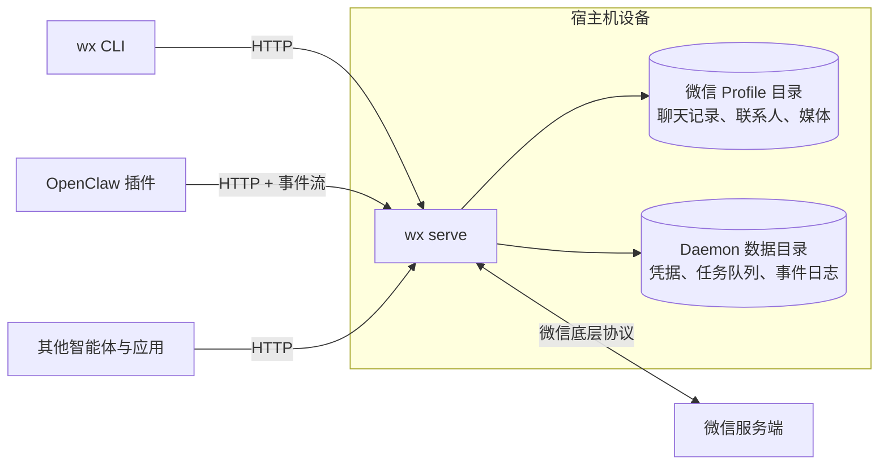

import { Aside } from '@astrojs/starlight/components';

`wx serve` 像官方桌面端一样直接对接微信底层网络协议。无需在后台运行官方微信应用、图形桌面或任何浏览器实例。

**微信 Profile 目录始终是数据主存储。** 聊天历史、联系人和媒体资源全部以 Linux 版微信原生兼容的加密格式保存，无论是 Daemon 初始新建的 Profile，还是通过 `--official` 挂载的现有官方目录。Daemon 接收或发出的消息会直接写入其中，效果等同于官方客户端亲自执行的操作。

**Daemon 独立保存内部元数据：** 包括登录凭据、发送/下载队列、事件审计流以及微信 Profile 无处安置的专有配置。

**所有客户端面向同一套 HTTP API。** CLI 仅仅是该 API 的轻量命令行封装。OpenClaw 插件通过监听 SSE 事件流并调用相同的 API 路由运行，任何第三方智能体插件或应用程序均可以此方式接入。参考 [HTTP API](/zh-cn/use/api/)。

## Daemon 内部模块组成

| 核心组件 | 职责分工 |
| --- | --- |
| 账号 Worker (Account worker) | 每个账号独立 Worker：管理与微信长连接、维持在线心跳，并按序执行写变更 |
| 同步引擎 (Sync) | 通过服务端推送长连接实时接收新消息；若连接掉线则平滑降级为轮询 |
| Profile 读写器 (Profile reader/writer) | 通过小型一致性快照池读取历史；为受支持的数据库结构维持单一写入者 |
| 任务队列 (Job queue) | 异步调度发送、下载、撤回与已读回执任务，支持跨进程重启状态持久化恢复 |
| 事件日志 (Event log) | 严格记录所有已提交的数据变更，供客户端重放追溯错过的增量事件 |
| HTTP 服务端 (HTTP server) | 提供 `/v1` REST 接口，校验令牌权限，提供 SSE 事件流长连接 |

对于处于独占管理且使用 SQLite WAL 日志模式的 Profile，Worker 会短暂暂停写入以捕获每个请求的数据库及事件位置快照。随后在请求读取与格式化结果期间释放写入锁。单个账号最多可并发执行 4 个读取操作，整个 Daemon 跨账号最多并发执行 8 个。使用其他日志模式的 Profile 则继续维持串行读取；Daemon 不会主动更改其数据库日志模式。

下载操作采用独立的并发限制：每个账号最多 2 个并发，整个 Daemon 最多 4 个并发。网络等待期间会释放账号的写入锁，并在保存结果前重新检查登录状态与任务状态。发送操作仍沿用原有的作业队列。发现并登记已保存的媒体文件仍然使用写入锁。

[`packages/native-client-rust`](https://github.com/thisnick/agent-wechat/tree/main/packages/native-client-rust) 下的 Rust Crate 同样遵循此职责划分：`wechat-protocol`、`wechat-profile`、`wechat-store`、`wechat-core`、`wechat-api` 以及可执行程序 `wx`。

如需直接调用底层库，请参考 [Rust 开发库](/zh-cn/reference/rust-libraries/)。

<Aside title="使用提示">
- **单个 Daemon 可同时托管多个账号**，每个账号具备独立的 Worker 进程、登录凭据和事件日志。
- **遇到未知协议格式严格留存而非盲目猜测。** 当微信下发 Daemon 尚未支持的数据载荷时，原始数据会被妥善存证，避免污染损坏 Profile。
- **一个 Profile 仅限单一写入者。** Daemon 在启动时会对 Profile 加排他锁，防止两个 Daemon 实例并发读写，但无法阻拦外部启动的官方微信桌面客户端。
</Aside>
