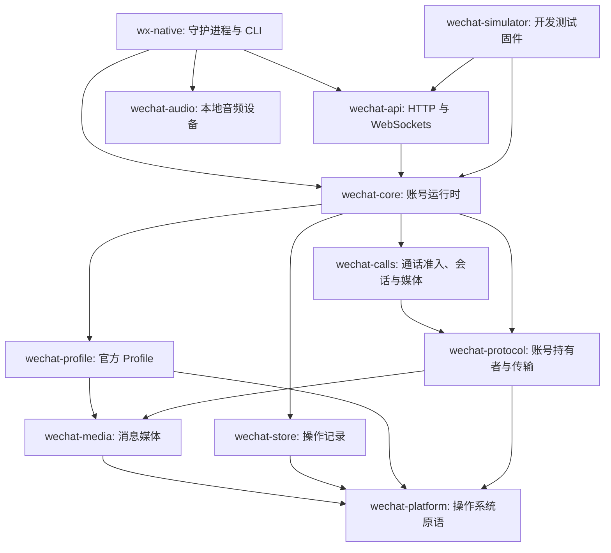

Rust 工作区将微信底层传输、官方 Profile 访问、账号编排以及客户端适配器分离开来。五个库公开发布；守护进程、CLI 以及其余运行时 Crate 保持内部使用。

## Package 依赖关系 \{#package-dependencies}

下方箭头表示“依赖于”。`wechat-protocol` **不**依赖 `wechat-calls`、`wechat-audio` 或 `wechat-profile`。

此处省略了通用工具库依赖。Core 负责守护进程内部的 PCM 信封封装；API 与 CLI 复用 `wechat-calls` 的音频格式类型。通话 Socket 使用带 Base64 PCM 的 JSON 消息，而守护进程负责组装并按节奏发送音频帧。

| Package | 职责 | 是否公开发布？ |
| --- | --- | --- |
| `wechat-platform` | 操作系统与文件系统原语 | 是 |
| `wechat-media` | 消息图像与媒体格式检查 | 是 |
| `wechat-profile` | 受支持的官方 Profile 读取器与写入器 | 是 |
| `wechat-protocol` | 拥有账号状态的 `NativeClient`、认证请求、信令与加密传输 | 是 |
| `wechat-calls` | 单账号通话准入、会话、媒体 Worker、音源追踪、PCM、节奏控制、混音与 Opus | 是 |
| `wechat-audio` | 麦克风/扬声器适配器与重采样 | 否 |
| `wechat-core` | 守护进程权限管理、Profile 集成、操作日志与通话编排 | 否 |
| `wechat-api` | HTTP 路由、认证控制/媒体 WebSocket 及数据契约 | 否 |
| `wechat-store` | 挂起的操作与故障恢复收据 | 否 |
| `wechat-simulator` | 合成测试后端与开发测试固件 | 否 |
| `wx-native` | `wx` 命令行程序、守护进程启动、CLI 交互及配置文件 | 否 |

`NativeClient` 拥有账号状态及认证请求的生命周期。克隆该客户端将共享同一账号，而不会创建另一个可变副本。Core 使用同一个客户端，并保留守护进程的权限管理与操作日志。

`wechat-calls` 中的通话准入模块决定由哪个控制器负责某次呼叫尝试，并判断请求是新的、重复的还是过期的。Core 使用的是同一套状态机。未决的呼叫提交会一直占用该账号的通话槽位，直至清理完成；单纯的超时并不构成再次发出邀请的依据。

权威的聊天数据始终保存在官方 Profile 中。通话操作记录不会另建历史数据库。通话会话直接使用 protocol Crate 的编解码器以及账号拥有的传输层。[可复用的 Rust 库](../../reference/rust-libraries/)介绍了它们的独立 API。

## 媒体适配层 \{#media-adapters}

客户端发送的 PCM 音频依次经过 API 与 Core 适配器进入 `wechat-calls` 媒体 Worker。这些 Worker 借助 `wechat-protocol` 的数据包编解码器处理节奏控制与 Opus 编码；接收音频的路径则相反。Core 负责提供守护进程权限、打断检查与事件派发；calls Crate 不依赖 Core、HTTP、持久化存储或设备。

| 依赖项 | 用途与位置 |
| --- | --- |
| `opusic-c = 1.6.1` | 包含在原生 `wechat-calls` 构建中；使用 libopus 进行音频编解码 |
| `rubato` | `wechat-audio` 中设备格式与通话格式之间的重采样 |
| `libpulse-binding` | Linux 平台的音频捕获与播放 |
| `coreaudio-rs` / `coreaudio-sys` | macOS 平台的音频捕获与播放，包括 VoiceProcessingIO |
| `wasapi` | Windows 平台的音频捕获与播放 |

`wechat-audio` 是我们对 sys-voice 和 acpfx 分支的内部改编版本，其上游许可证与源码版本锁定信息保留在[第三方来源文件](https://github.com/thisnick/agent-wechat/blob/main/packages/native-client-rust/crates/wechat-audio/THIRD-PARTY.md)中。设备配置完成并不代表已测得回声消除的声学质量。

私有的 TypeScript HTTP/WebSocket SDK 与 OpenClaw 扩展通过守护进程通信；二者在 Node 中都不需要 libopus 或操作系统音频绑定。Rust 守护进程仍有原生依赖。项目不提供独立的 JavaScript 微信传输实现。

## 源码构建 \{#building}

[从源码构建](../../reference/build/)介绍了工作区构建及各平台的前置条件。[通话](../../reference/calls/)说明了守护进程、CLI 与 OpenClaw 的用法；[通话 API](../../reference/calls-api/)负责通话的载荷与事件。
