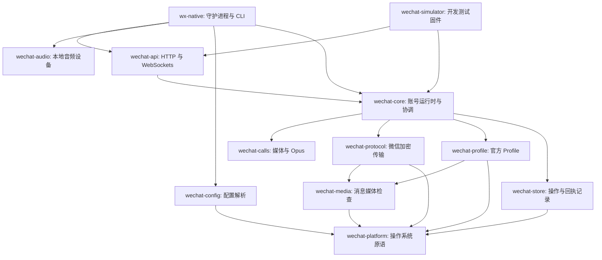

Rust 工作区分离了微信底层传输、官方 Profile 访问、账号编排以及客户端适配器。四个核心库公开发布在 crates.io 上；守护进程、CLI 以及支撑运行时 Crate 保持私有内部使用。

## Package 依赖关系

下方箭头表示“依赖于”。`wechat-protocol` **不**依赖 `wechat-calls`、`wechat-audio` 或 `wechat-profile`。

此处省略了通用工具库依赖。API 使用 `wechat-calls` 处理内部 PCM 信封封装；CLI 复用其音频格式定义。客户端 Socket 传输原始 PCM 采样与 JSON 元数据，而守护进程负责组装与控制音频帧时钟步调。

| Package | 职责与功能 | 是否公开发布? |
| --- | --- | --- |
| `wechat-platform` | 操作系统与文件系统原语 | 是 |
| `wechat-media` | 消息图像与媒体格式检查 | 是 |
| `wechat-profile` | 受支持的官方 Profile 读取器与写入器 | 是 |
| `wechat-protocol` | 微信请求、信令与加密传输协议 | 是 |
| `wechat-calls` | PCM 帧封装、时钟步调、队列与可选 Opus 编解码 | 否 |
| `wechat-audio` | 麦克风/扬声器适配器与重采样 | 否 |
| `wechat-core` | 账号鉴权、所有权排他、通话状态与 Worker | 否 |
| `wechat-api` | HTTP 路由、认证控制/媒体 WebSocket 及数据契约 | 否 |
| `wechat-store` | 挂起的操作与故障恢复收据 | 否 |
| `wechat-config` | CLI 与守护进程配置文件解析 | 否 |
| `wechat-simulator` | 合成测试后端与开发测试夹具 | 否 |
| `wx-native` | `wx` 命令行程序、守护进程入口及 CLI 交互 | 否 |

权威的聊天数据始终保存在官方 Profile 中。通话操作记录不会额外创建平行的历史数据库。四个公开发布的底层库保持精简独立。[Rust 开发库](../../zh-cn/reference/rust-libraries/)详细介绍了它们独立的 API。

## 媒体适配层

客户端发送的 PCM 音频依次经过 API、Core 通话 Worker、`wechat-calls` 编码与 `wechat-protocol` 传输；接收音频则沿反向流动。参数协商属于 Worker 和传输层的职责，而不是音频设备适配器。

| 依赖项 | 用途与位置 |
| --- | --- |
| `opusic-c = 1.6.1` | 包含在原生 `wechat-calls` 构建中；使用 libopus 进行音频编解码 |
| `rubato` | 在 `wechat-audio` 中负责设备采样率与通话采样率之间的重采样 |
| `libpulse-binding` | Linux 平台的音频捕获与播放 |
| `coreaudio-rs` / `coreaudio-sys` | macOS 平台的音频捕获与播放（包含 VoiceProcessingIO 语音处理） |
| `wasapi` | Windows 平台的音频捕获与播放 |

`wechat-audio` 是我们对 sys-voice 和 acpfx 分支的内部适配实现，在 [第三方来源文件](https://github.com/thisnick/agent-wechat/blob/main/packages/native-client-rust/crates/wechat-audio/THIRD-PARTY.md) 中完整保留了上游许可证与源码锁定。音频设备就绪并不代表具备已实测验证的回声消除质量。

私有的 TypeScript HTTP/WebSocket SDK 以及 OpenClaw 插件通过网络与守护进程通信；二者在 Node.js 环境下均无需 libopus 或操作系统底层音频绑定。Rust 守护进程仍包含原生二进制依赖。项目不提供纯 JavaScript 实现的微信传输协议。

## 源码构建

[源码构建](../../zh-cn/reference/build/) 介绍了工作区编译及各系统先决条件。[实时通话](../../zh-cn/reference/calls/) 详细介绍了守护进程、CLI 与 OpenClaw 的使用；[通话控制 API](../../zh-cn/reference/calls-api/) 则列出了具体的控制载荷与事件格式。
