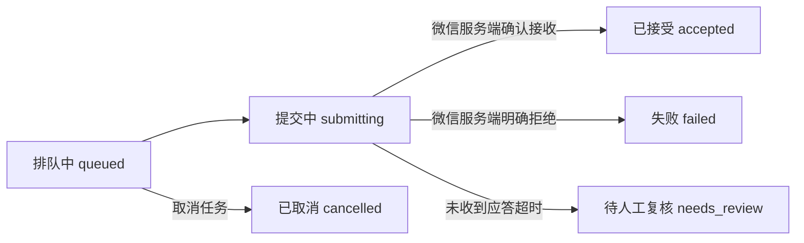

import { Aside } from '@astrojs/starlight/components';

在消息发送过程中，可能会遭遇一种尴尬的故障：微信服务端已经成功接收了消息，但在向客户端返回 ACK 确认时网络发生了中断。如果客户端此时无脑重发，就会在群里造成消息轰炸和内容重复。因此，agent-wechat 为每一次发送都强制绑定了 **幂等键 (Idempotency Key)**，对于未决结果一律如实报告，绝不擅自自动盲目重试。



| 状态值 | 业务含义 | 应对方案 |
| --- | --- | --- |
| `accepted` | 微信服务端已确认接收该消息 | 无需操作。（注：这不代表对方手机一定已联网收到） |
| `failed` | 微信服务端明确拒绝该请求 | 排查具体原因，修正后换用一个 **全新的** 幂等键重新发送 |
| `needs_review` | 状态未决：消息可能已经发出，也可能未发出 | 打开手机微信查看该会话实际情况。切勿自动化盲目重发。 |
| `cancelled` | 在正式向服务端提交前任务已被主动取消 | 无需操作 |

## 相同幂等键，对应同一条发送

CLI 在正式发出网络请求前，会首先在本地保存一份带有该幂等键的收据。如果网络中途断开，请使用该键查询已有记录，而非再次调用发送：

```bash
wx messages sends lookup --idempotency-key order-1234-confirmation
wx jobs get JOB_ID
```

使用相同的幂等键和完全相同的内容再次提交，接口将幂等返回初次发送的已有记录。如果幂等键相同但请求体内容发生了变化，请求将被系统明确拒绝。

## 服务重启后的恢复机制

已排队的待发送任务、正在进行的下载、未完成的已读通知、事件审计日志以及登录授权凭证均能够完整跨越服务重启。在 Daemon 异常退出时正处于在途提交阶段的任务，在重启后会被标记为 `needs_review`，防止拉起后无脑二次重复发送。

正常停止 Daemon（或断开网络连接）不会导致微信账号下线。只有显式执行 `wx auth logout` 才会真正退出登录；退出登录后，除非再次通过终端扫码登录，否则 Daemon 绝不会自动发起重连。

<Aside title="使用提示">
- **时长超过 60 秒的语音会被自动拆分** 为若干等长的连续语音条。部分成功的拆分结果中会保留已成功发出的语音条 ID 列表。
- **关闭终端或断开 HTTP 请求不会取消后台执行。** 在 CLI 按 Ctrl-C 或客户端断开 HTTP 连接并不会中断 Daemon 在后台已启动的发送流程。
- **媒体本地回读修复：** 如果已成功发送或下载的文件未能顺利写入 Profile 对应的微信个人目录中，执行 `wx jobs repair-writeback` 可以直接利用 Daemon 已有的本地文件完成修复，绝不额外发起二次网络下载或发送。
- **切勿随意删除数据文件来尝试重新登录。** 盲目删库可能会导致本地设备信任凭据、数据库解密密钥以及处于在途状态的本地收据永久丢失。
</Aside>
