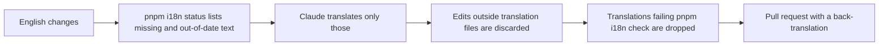

import { Aside } from '@astrojs/starlight/components';

英文文本变动后，机器人会使用 Claude 将新增和改动的文本翻译成各种语言，并提交一个拉取请求供审阅：

| 英文变动于 | 译文提交至 |
| --- | --- |
| 你的拉取请求 | `i18n/pr-<number>`，基于你分支的拉取请求 |
| main（分叉仓库的拉取请求或直接推送） | `i18n/sync`，基于 main 的拉取请求 |

1. 阅读机器人的拉取请求。其末尾附有回译为英文的内容，因此即使你不懂该语言，也能审阅。
2. 先将其合并到你的分支，再合并你的分支。

机器人只能修改译文文件，并会丢弃任何未通过 `pnpm i18n check` 的译文，因此相应文本将保持英文。它所撰写的文档页面会显示“机器翻译”横幅，直到有人审阅该页面并从其 frontmatter 中删除 `banner`。

## 机器人的工作流程 \{#what-the-bot-does}

每份译文都会记录它所依据的英文版本，因此机器人只翻译新增或改动的内容，其余部分保持不变。若要自行修正或新增译文，请参见[翻译](/reference/translate/)。

<Aside title="使用提示">
- 机器人会跳过草稿和来自分叉仓库的拉取请求；这些内容的英文会在合并到 main 后再翻译。每当英文再次变动，机器人都会重建其拉取请求，因此请先合并，再进行编辑。
- 机器人开启的拉取请求不会自动触发 CI。机器人在发布前会运行 `pnpm i18n check`，合并后 CI 会在你的分支上运行。
- 机器人使用 Claude Haiku，并遵循 `docs/i18n/glossary/` 中该语言的术语表。它在 `.github/workflows/i18n-translate.yml` 中运行。
</Aside>
