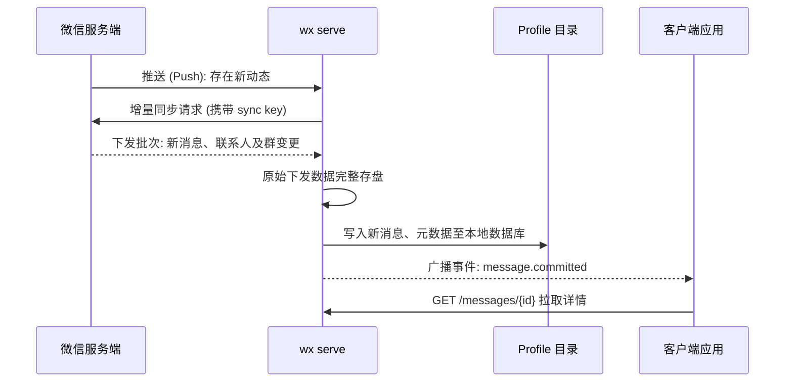
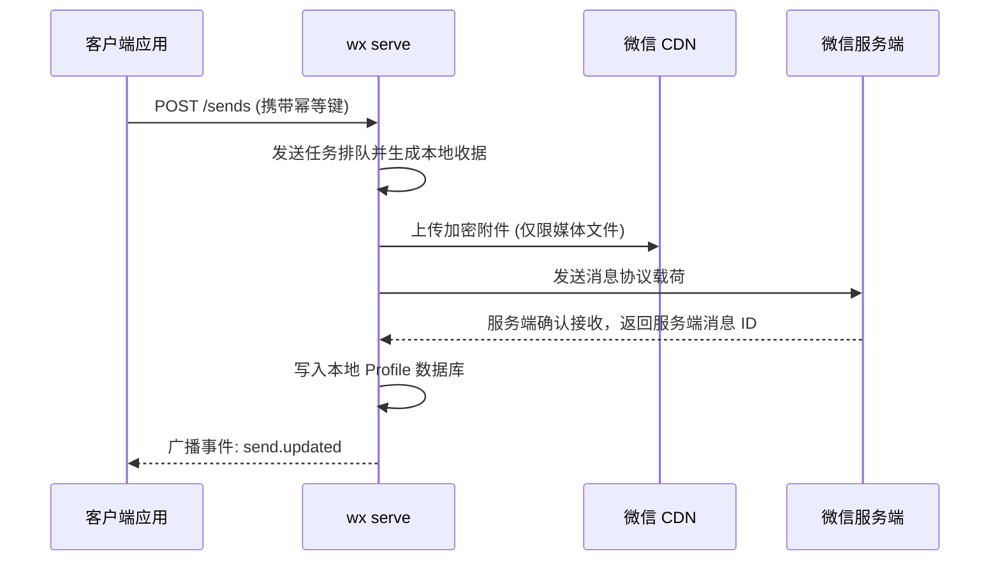

import { Aside } from '@astrojs/starlight/components';

`wx serve` 像微信桌面端一样连接微信服务端：它以一个已登录设备的身份与你的账号绑定。其余功能都建立在以下四类交互之上。

## 1. 登录与维持会话 \{#1-staying-logged-in}

扫码登录时，微信会签发与该设备标识绑定的凭据，Daemon 将其加密保存在数据目录中。连接期间，Daemon 按微信的要求发送心跳。重启后，它会用已保存的凭据重新连接，绝不会自行发起新的扫码登录。

若微信以需要认证为由拒绝当前的推送、心跳或同步会话，Daemon 会在本地退出登录并停止重连。此时账号状态显示 `authenticated: false` 与 `connection: "disconnected"`；账号事件中会包含 `auth_required`、请求来源，以及可用时的服务码。你的 Profile、聊天记录和已保存的凭据都会保留。运行 `wx auth login` 即可重新登录。暂时性的连接故障则会持续重试。

## 2. 接收消息与增量同步 \{#2-receiving}

1. Daemon 与服务端维持一条长连接推送通道。推送通知仅告知存在新事件，并不携带任何实际内容。
2. Daemon 携带上一次保存的 **sync key** 向服务端发起增量拉取。微信返回变动批次以及新的 sync key。
3. 原始下发的数据批次会首先完整落盘暂存，以防数据库写入中途异常导致数据丢包。
4. 将变动完整写入本地 Profile：包含新消息、未读计数、联系人和群聊变动。
5. 只有在本地完成提交写入后，才会将新消息封装为 `message.committed` 事件对外广播。客户端监听[事件流](/use/api/#receive)，拉取详情，并提交消费已读进度位点。

若长连接推送通道中断，Daemon 会改为轮询，直到连接恢复（参见 `wx accounts status` 中的 `incomingTransport`）。离线期间收到的消息会在重连时通过一个追赶批次取回。这些消息会被正常存储，但会标记为追赶（catch-up），以免客户端将其当作新消息处理。

## 3. 发送消息 \{#3-sending}

纯文本消息直接投递给微信服务端。多媒体资源则需要先在本地进行格式预处理（校验图片规范、使用 FFmpeg 转码音视频、将音频编码为微信专用的 SILK 语音格式），随后加密上传至微信官方 CDN 并回读校验。全部校验通过后，才会发送指向该 CDN 资源的正式消息。每一条发送请求均绑定唯一的幂等键，重试绝不产生重复发送。详见[消息发送与恢复机制](/how-it-works/sends/)。

## 4. 媒体下载与已读同步 \{#4-media-and-read-state}

**媒体下载：** 收到的图片、文件、视频或语音消息只包含一个指向微信 CDN 上加密文件的引用。客户端请求时，Daemon 会下载并解密该文件，校验大小与哈希，然后缓存到 Profile 中。微信 CDN 上的副本过期后，已缓存的文件仍可继续使用。

**已读状态：** 标记会话已读会清空 Profile 数据库中该会话的本地未读计数，并向微信服务端发送已读确认通知，以便你的手机微信和电脑端同步消除红点未读提示。日常查看历史记录不会自动触发已读通知，仅在明确发出已读指令时才会生效。

来自手机或其他登录设备的受支持的已读、打开会话和退出会话通知，同样会更新本地的未读计数。打开和退出会话的处理仅针对当前可见的普通会话，并会保留晚于该通知的新消息。这类处理不会反向发送已读通知。

## 客户端消费模型 \{#clients}

所有客户端仅面向 HTTP API 与 SSE 事件流。各个客户端根据自身业务逻辑决定如何处理消息：

- **CLI 命令行：** 监听并打印事件 (`wx events watch`)，支持交互式发送。
- **OpenClaw：** 审查发送者权限、下载多媒体、交由大模型推理、执行回复并在完成后将会话标记为已读。参考[响应权限控制](/openclaw/access/)和[已读回执](/openclaw/read-receipts/)。
- **自定义业务代码：** 通过 [HTTP API](/use/api/) 自由集成。

<Aside title="使用提示">
- **无法应用的变更会被跳过，但会保留下来。** 例如 Daemon 不支持的状态和系统通知、对你自己 Profile 的更新，以及名片等消息类型。Daemon 会先应用它支持的部分：即使是打开或退出会话的通知，也仍会清除未读状态。其余未应用的内容保存在 `control.sqlite` 中，并发出一条 `projection: "skipped"` 的 `account.control_observed` 事件，然后同步检查点继续推进。
- **后续工作在后台进行。** 群聊变更、表情同步通知，或包含 Daemon 无法归类字段的联系人变更，会立即确认。随后 Daemon 会在后台分别刷新群聊、重新同步表情或单独查询该联系人，因此这些工作都不会扣住同步检查点。
- **你在手机上发出的消息同样会被同步接收，** 表现为来自你自己微信 ID 的 `outgoing` 发送方向消息。负责自动回复的机器人应当主动跳过这类由本人发出的消息。
- **消息撤回同样作为变更事件同步下发。** 本地数据库中的原消息内容会被替换为 `[Message recalled]`，并触发 `message.recalled` 事件。
- **手机微信始终拥有最高控制权。** Daemon 只是以一个额外登录设备的身份加入会话；它发出的消息会同步在你的手机端聊天界面中显示，如同在电脑版微信上打字一样。
</Aside>
