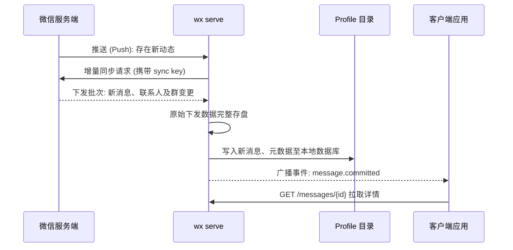
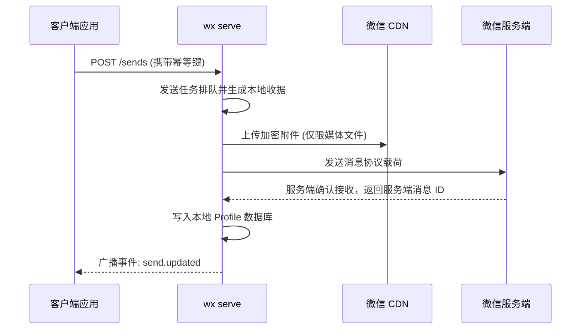

import { Aside } from '@astrojs/starlight/components';

`wx serve` 像微信官方桌面端一样接入微信服务端：在你的账号下作为一个已授权登录的独立设备存在。所有的核心功能均围绕以下四类交互链路构建。

## 1. 登录与维持会话

扫码登录时，微信会为该设备身份签发授权凭据，Daemon 会将其以安全加密形式保存在其数据目录中。在连接期间，Daemon 会按微信服务端的协议规范定期发送心跳包保活。在服务重启后，它会使用已保存的凭据自动重连，绝不会擅自重新生成二维码要求二次扫码。

如果微信服务端明确拒绝了当前的推送、心跳或同步会话并要求重新授权认证，Daemon 将在本地安全登出并停止重试。此时账号状态显示 `authenticated: false` 与 `connection: "disconnected"`；账号事件中会推送 `auth_required`、请求来源及服务端状态码（若存在）。你的 Profile、聊天记录和已保存凭据将完好保留。重新运行 `wx auth login` 即可再次上线。对于常规的暂时性网络抖动，Daemon 会持续自动重试重连。

## 2. 接收消息与增量同步

1. Daemon 与服务端维持一条长连接推送通道。推送通知仅告知存在新事件，并不携带任何实际内容。
2. Daemon 携带上一次保存的 **sync key** 向服务端发起增量拉取。微信返回变动批次以及新的 sync key。
3. 原始下发的数据批次会首先完整落盘暂存，以防数据库写入中途异常导致数据丢包。
4. 将变动完整写入本地 Profile：包含新消息、未读计数、联系人和群聊变动。
5. 只有在本地完成提交写入后，才会将新消息封装为 `message.committed` 事件对外广播。客户端监听[事件流](/zh-cn/use/api/#接收事件)，拉取详情，并提交消费已读进度位点。

若长连接推送通道中断，Daemon 将自动平滑降级为轮询模式直到网络恢复（参见 `wx account status` 中的 `incomingTransport`）。离线期间累积的所有消息将在重连后一次性拉取，虽然正常写入，但会被标记为 catch-up 追赶消息，避免客户端将其视作即时新消息触发突发响应。

## 3. 发送消息

纯文本消息直接投递给微信服务端。多媒体资源则需要先在本地进行格式预处理（校验图片规范、使用 FFmpeg 转码音视频、将音频编码为微信专用的 SILK 语音格式），随后加密上传至微信官方 CDN 并回读校验。全部校验通过后，才会发送指向该 CDN 资源的正式消息。每一条发送请求均绑定唯一的幂等键，重试绝不产生重复发送。详见[消息发送与恢复机制](/zh-cn/how-it-works/sends/)。

## 4. 媒体下载与已读同步

**媒体下载：** 接收到的图片、文件、视频或语音消息在协议层面仅是指向微信 CDN 加密资源的引用。当客户端主动请求时，Daemon 会拉取该文件、解密、校验体积与哈希，并缓存在本地 Profile 目录中。已下载的本地缓存文件在微信云端文件过期后依旧能够长期打开使用。

**已读状态：** 标记会话已读会清空 Profile 数据库中该会话的本地未读计数，并向微信服务端发送已读确认通知，以便你的手机微信和电脑端同步消除红点未读提示。日常查看历史记录不会自动触发已读通知，仅在明确发出已读指令时才会生效。

来自手机或其他登录设备的已读、打开会话和退出会话通知同样会同步更新本地的未读计数。在打开和退出会话的处理中，会更新当前可见的普通会话，并保留晚于通知时间戳的新消息，且绝不会向服务端反向多发一次已读通知。

## 客户端消费模型

所有客户端仅面向 HTTP API 与 SSE 事件流。各个客户端根据自身业务逻辑决定如何处理消息：

- **CLI 命令行：** 监听并打印事件 (`wx events watch`)，支持交互式发送。
- **OpenClaw：** 审查发送者权限、下载多媒体、交由大模型推理、执行回复并在完成后将会话标记为已读。参考[响应权限控制](/zh-cn/openclaw/access/)和[已读回执](/zh-cn/openclaw/read-receipts/)。
- **自定义业务代码：** 通过 [HTTP API](/zh-cn/use/api/) 自由集成。

<Aside title="使用提示">
- **Daemon 无法解析的协议字段会严格存盘而非跳过。** 这些未知数据会暂存留底并阻止 sync checkpoint 盲目推进，确保重要数据绝不无故静默遗失。
- **部分状态更新属于部分受支持。** 例如收到打开会话或退出会话通知时，可以正确清空未读数，但该会话协议包中携带的其他私有会话属性由于未完全解码，仍会扣住 sync checkpoint 并触发 `projection.blocked`。此时常规新消息仍可正常流转收发。
- **你在手机上发出的消息同样会被同步接收，** 表现为来自你自己微信 ID 的 `outgoing` 发送方向消息。负责自动回复的机器人应当主动跳过这类由本人发出的消息。
- **消息撤回同样作为变更事件同步下发。** 本地数据库中的原消息内容会被替换为 `[Message recalled]`，并触发 `message.recalled` 事件。
- **手机微信始终拥有最高控制权。** Daemon 只是以一个额外登录设备的身份加入会话；它发出的消息会同步在你的手机端聊天界面中显示，如同在电脑版微信上打字一样。
</Aside>
