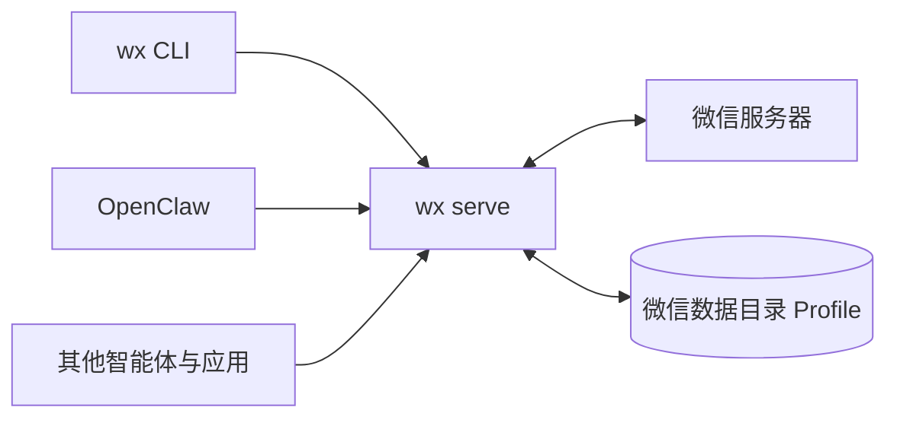

import { Card, CardGrid } from '@astrojs/starlight/components';



`wx serve` 直接与微信底层协议通信，无需运行微信桌面端或任何图形界面。它以微信官方原生格式存储所有数据，能够直接继承现有的 Linux 版微信历史数据与会话。所有客户端均通过其 HTTP API 通信：包括 `wx` 命令行工具、OpenClaw 插件以及任何自建应用。原生桌面客户端也在计划中。

```bash
npm install -g --allow-scripts=@agent-wechat/cli @agent-wechat/cli
wx serve                          # 终端 1：启动后台服务
wx accounts create --alias me     # 终端 2：创建账号
wx auth login                     # 使用手机微信扫码登录
wx chats list                     # 列出会话列表
```

<CardGrid>
  <Card title="安装配置" icon="rocket">
    安装、登录、后台持续运行，或从旧容器平滑迁移。[准备条件 →](/zh-cn/setup/requirements/)
  </Card>
  <Card title="使用指南" icon="puzzle">
    支持 CLI 命令、OpenClaw 接入，或对接专属智能体与应用。[CLI 常用命令 →](/zh-cn/use/cli/)
  </Card>
  <Card title="工作原理" icon="information">
    深入了解 Daemon 后台服务、消息流转、发送机制以及数据存储。[架构设计 →](/zh-cn/how-it-works/architecture/)
  </Card>
</CardGrid>
