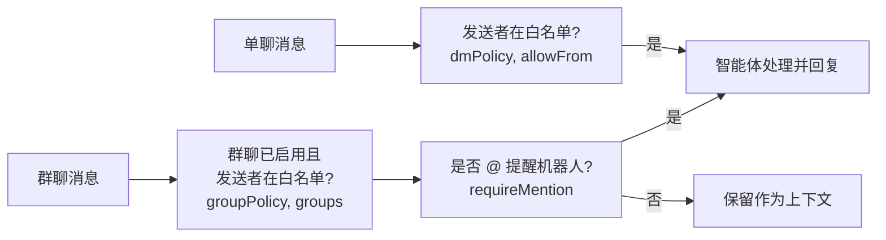

import { Aside } from '@astrojs/starlight/components';

每一条收到的新消息在呈现给智能体之前，均须通过严格的前置安全校验。默认策略下拦截所有消息。



未通过校验的消息将被直接忽略，并在你的微信中保持未读。

## 单聊控制 (Direct Messages) \{#direct-messages}

| `dmPolicy` 策略 | 允许谁触发回复 |
| --- | --- |
| `disabled` (默认) | 拒绝所有人 |
| `allowlist` | 仅允许 `allowFrom` 白名单中列出的联系人 |
| `open` | 允许任何私聊你的微信好友 |

## 群聊控制 (Groups) \{#groups}

| `groupPolicy` 策略 | 允许谁在群里触发回复 |
| --- | --- |
| `disabled` (默认) | 拒绝所有群消息 |
| `allowlist` | 允许 `groupAllowFrom` 中的人员（若未设置则继承 `allowFrom`） |
| `open` | 允许该群内的任何成员 |

在群聊中，智能体默认仅在被 **@ 提及** 时才会作出回复。下一次被 @ 提醒时，会把该群中智能体上次回复之后的消息作为上下文，从聊天记录中读取并提供给模型。

可在 `groups` 中为各个特定群聊定制覆盖规则（以群 ID 为键，`"*"` 代表全局兜底）：

```json
"agent-wechat": {
  "dmPolicy": "allowlist",
  "allowFrom": ["wxid_alice", "wxid_bob"],
  "groupPolicy": "allowlist",
  "groups": {
    "*": { "enabled": false },
    "family@chatroom": { "enabled": true, "requireMention": false },
    "project@chatroom": { "enabled": true, "allowFrom": ["wxid_carol"] }
  }
}
```

在该配置下：智能体会直接回复 Alice 和 Bob 的私聊。在家人群中，无需 @ 即可直接响应 Alice 和 Bob 的消息。在项目群中，仅在 Carol @ 机器人时才予回复。其余未提及的群聊全部保持静默。

## OpenClaw 关闭期间收到的消息 \{#messages-that-arrive-while-openclaw-is-off}

Gateway 重新启动后，智能体会补回离线期间错过的消息：

| 错过的消息 | 处理方式 |
| --- | --- |
| 24 小时内发送的 | 若通过上述校验，则予以回复 |
| 超过 100 条 | 仅回复最新的 100 条 |
| 24 小时以前发送的 | 跳过 |

只有通过上述校验的消息才计入这 100 条，包括 Gateway 停止时正在等待处理的消息。未 @ 提醒的群消息仍会作为下一次 @ 提醒的上下文出现。被跳过的消息会记录在 Gateway 日志中。

<Aside title="使用提示">
- **查询 ID：** 用户 ID 可通过 `wx contacts find 姓名` 获取；群聊 ID 可通过 `wx chats find 群名` 获取（以 `@chatroom` 结尾）。你自己的 ID 为已发消息中的 `senderId`。
- **@ 提醒指微信原生的 @ 结构化元数据**（包括命中你或全员 @所有人）。Daemon 直接读取微信底层协议中的元数据，手打纯文本形式的“@机器人”不会被识别。参见[群成员 @ 提醒](/use/groups/#mention-group-members)。
- **群聊上下文长度：** `messages.groupChat.historyLimit` 用于控制每个群最多暂存多少条未 @ 提醒的历史上下文（默认为 50 条，上限 200 条，设为 0 完全关闭）。上下文只包含智能体可能回复的人发送的消息，绝不包含你自己发送的消息。上下文中的图片只有在真正触发回复时才会下载。
- **被撤回的消息** 会立即从上下文缓存中剔除，即便此前从未回复过。
- **媒体附件在发送者校验之后拉取。** 被策略拦截忽略的消息，其附件绝不会被下载或送入转录流程。
</Aside>
