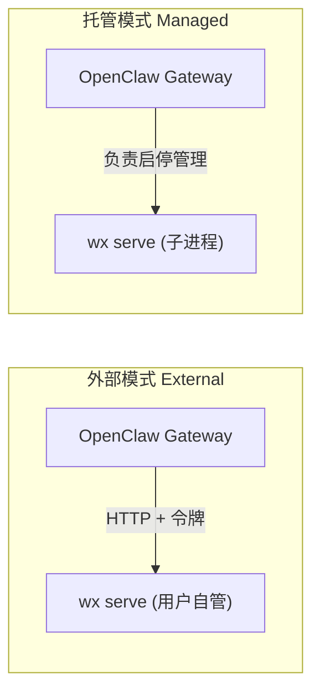

import { Aside } from '@astrojs/starlight/components';



| 特性对比 | 外部模式 (External) | 托管模式 (Managed) |
| --- | --- | --- |
| 谁来运行 `wx serve` | 用户自管：`wx daemon`、systemd 或 Docker | OpenClaw 作为子进程负责启停 |
| 部署位置 | Gateway 可访问的任意网络地址 | 与 Gateway 位于同一台物理机 |
| Gateway 所在机器是否需要 `wx` | 否 | 是 |
| Gateway 退出时 | Daemon 依然保持后台运行 | Daemon 随之停止退出 |
| 适用场景 | 习惯在终端使用 CLI，或在 Docker 中部署 Daemon | 希望单进程统一管理所有组件 |

**外部模式 (External)** 是默认推荐的方式。[快速上手配置](/zh-cn/openclaw/setup/) 采用的即是外部模式。

## 托管模式 (Managed Mode)

先停止正在使用该数据目录的任何其他 Daemon 实例，然后调整 `native` 配置块：

```json
"native": {
  "mode": "managed",
  "accountId": "ACCOUNT_ID",
  "dataDir": "/home/you/.local/share/agent-wechat",
  "listen": "127.0.0.1:6174",
  "token": { "source": "env", "provider": "default", "id": "AGENT_WECHAT_TOKEN" },
  "consumerStateDir": "/home/you/.openclaw/agent-wechat"
}
```

OpenClaw 默认会在系统的 `PATH` 路径中查找 `wx`，也可以通过 `executable` 显式指定其绝对路径。在切换到托管模式前，请先[使用 CLI 登录](/zh-cn/setup/connect/)该账号；插件本身不会自动为你唤起交互式登录。

<Aside title="使用提示">
- **托管模式不会在 Daemon 异常崩溃时自动拉起。** Gateway 将上报该异常错误；重启 Gateway 即可完成恢复。
- **不会抢占已被占用的端口，** 且绝不会擅自杀掉非自身创建的外部进程。
- **令牌直接通过内部管道传入子进程，** 而非作为文件、命令行参数或环境变量暴露。与托管模式配合使用的 `serverConfig` 严禁配置 `tokenFile`。
- **外部模式绝不负责停止或登出** Daemon。停止 Gateway 仅断开彼此间的通信长连接。
- **连接远程 Daemon 时，** 请使用 HTTPS 或加密网络隧道。Daemon 本身只绑定在 localhost。
- 单个 OpenClaw 微信通道对应接入一个微信账号。
</Aside>
