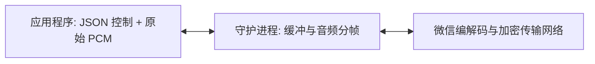

在通话媒体 WebSocket 上收发 **原始 PCM16 Little-Endian 采样**。
二进制消息纯粹包含音频数据。JSON 文本消息用于通道附加、格式协商与流控制信息。协议没有自定义二进制报头或 WAV 容器头。
守护进程负责音频分帧、步调控制、编解码及与微信服务端的加密传输。



## 附加通道并交换音频

1. 通过[通话控制 API](../calls-api/) 认领并接听通话，等待 `call.state` 汇报 `state: "connected"`。保持拥有所有权的控制 WebSocket 处于开启状态。
2. 以相同账号携带 `calls` Bearer 鉴权请求头打开 `/v1/accounts/{account}/calls/{callId}/media`。必须在 5 秒内发送以下初始握手 JSON：

   ```json
   {
     "type": "media.attach",
     "clientId": "example-client",
     "ownerToken": "<保密的所有者令牌 ownerToken>"
   }
   ```

3. 等待 **媒体** Socket 回复以下就绪 JSON。其中的方向（direction）相对于你的应用程序；请使用汇报的格式与代际：

   ```json
   {
     "type": "media.ready",
     "sendTrack": {
       "id": 1,
       "generation": 1,
       "direction": "send",
       "format": {
         "sampleRate": 16000,
         "channels": 1,
         "frameMs": 20
       }
     },
     "receiveTrack": {
       "id": 2,
       "generation": 1,
       "direction": "receive",
       "format": {
         "sampleRate": 16000,
         "channels": 1,
         "frameMs": 20
       }
     }
   }
   ```

4. 音频流就绪后，直接在 WebSocket 上双向传输数据：
   - 发送前先发送 `{"type": "audio.start", "generation": 1}` 表明开始推流；
   - 随后向 WebSocket 发送无头部包装的原始 PCM16-LE 单声道 16 kHz 二进制数据块。守护进程会自动按 20 ms 时钟步调向微信投递；
   - 接收到的二进制 WebSocket 消息直接为对端送达并解码的 PCM 音频块。

| 限制项 | 规格说明 |
| --- | --- |
| 客户端发送格式 | 严格 16000 Hz、单声道（1 Channel）、Signed 16-bit Little-Endian PCM |
| 帧长步调 | 20 毫秒（每帧 320 个采样点，即 640 字节） |
| 守护进程发送缓冲队列 | 最多缓存 8 秒音频 |

客户端发送的数据块不需要恰好是 20 ms。守护进程会自动合并较小的数据块、拆分较大的数据块并以固定时钟分帧。消费接收到的二进制消息时请按 PCM 字节流读取，不要依赖网络数据包边界。该 API 不提供采样率或编码码率调整选项。

## 直接使用 Node.js 的调用示例

安装常用的第三方 WebSocket 库：

```bash
npm install ws
```

agent-wechat 暴露标准的 HTTP/WebSocket API；其内部的 TypeScript 适配器不作为独立 SDK 发布。该示例直接使用 `ws` 库。

保持拥有通话所有权的**控制** Socket 处于开启状态。从其 `hello` 事件中获取 `WX_CLIENT_ID`，从拨号或接听成功的返回结果中获取 `WX_CALL_ID` 与 `WX_OWNER_TOKEN`。`WX_ACCOUNT_ID`、`WX_TOKEN` 与 `WX_BASE_URL` 对应于建立控制连接时的同一守护进程与账号。

```js
import WebSocket from "ws";

const {
  WX_BASE_URL = "http://127.0.0.1:6174",
  WX_ACCOUNT_ID,
  WX_TOKEN,
  WX_CALL_ID,
  WX_CLIENT_ID,
  WX_OWNER_TOKEN,
} = process.env;

if (![WX_ACCOUNT_ID, WX_TOKEN, WX_CALL_ID, WX_CLIENT_ID, WX_OWNER_TOKEN].every(Boolean)) {
  throw new Error("请设置环境变量：账号、Bearer 令牌及控制 Socket 返回的所有者凭据");
}

const url = new URL(WX_BASE_URL);
url.protocol = url.protocol === "https:" ? "wss:" : "ws:";
url.pathname = `/v1/accounts/${encodeURIComponent(WX_ACCOUNT_ID)}/calls/${encodeURIComponent(WX_CALL_ID)}/media`;
const media = new WebSocket(url, {
  headers: { Authorization: `Bearer ${WX_TOKEN}` },
});

media.on("open", () => {
  media.send(JSON.stringify({
    type: "media.attach",
    clientId: WX_CLIENT_ID,
    ownerToken: WX_OWNER_TOKEN,
  }));
});

media.on("message", (data, isBinary) => {
  if (isBinary) {
    // 默认二进制类型下，data 为原始 PCM16-LE 的 Buffer。
    console.log("收到 PCM 字节数:", data.length);
    return;
  }

  const event = JSON.parse(data.toString());
  if (event.type === "media.ready") {
    const { sendTrack } = event;
    media.send(JSON.stringify({
      type: "audio.start",
      generation: sendTrack.generation,
    }));
    // 发送 20ms 的静音数据（640 字节）。实际使用时替换为你的 PCM 采样。
    media.send(Buffer.alloc(640));
  } else if (event.type === "call.error") {
    console.error("媒体连接被拒绝:", event.code);
    media.close();
  }
});

media.on("error", () => {
  console.error("媒体连接发生错误");
});
```

## 媒体端点交互载荷

| 方向 | WebSocket 消息类型 | 载荷说明 |
| --- | --- | --- |
| 客户端 → 守护进程 | 首条文本消息 | `media.attach`: `clientId`, `ownerToken` |
| 守护进程 → 客户端 | 文本响应 | `media.ready`: `sendTrack`, `receiveTrack`（含 ID、代际 generation、方向与格式） |
| 客户端 → 守护进程 | 发送 PCM 前的文本消息 | `audio.start`: `generation` |
| 双向 | 二进制消息 | 仅传输原始 PCM16 Little-Endian 采样点数据 |
| 守护进程 → 客户端 | 附加失败时的文本响应 | `call.error`: `code` |

完整的握手与启动流程参见[附加通道并交换音频](#附加通道并交换音频)。`audio.start` 没有单独的服务端 ACK；该 Socket 随后发送的二进制消息均归属于该代际。消费接收到的 PCM 数据不需要提前发起外发音频流。若附加失败，将返回如下错误：

```json
{
  "type": "call.error",
  "code": "not_owner"
}
```

## 静音与打断机制

对端的麦克风状态会作为 [`call.control`](../calls-api/#参与者控制事件) 推送到控制 Socket 上。请继续正常处理 PCM：对端静音时仍在通话中，其麦克风状态不会影响你的外发音频。

在**控制** Socket 上发送以下 JSON 命令：

```json
{
  "type": "call.mute",
  "requestId": "mute-1",
  "callId": "example-call",
  "muted": true
}
```

```json
{
  "type": "call.clear_audio",
  "requestId": "interrupt-1",
  "callId": "example-call"
}
```

静音会抑制外发音频。清空音频队列（打断）会丢弃已排队的外发音频，并递增其音频流代际 (generation)。**控制** Socket 会通知：

```json
{
  "type": "track.updated",
  "callId": "example-call",
  "track": {
    "id": 1,
    "generation": 2,
    "direction": "send",
    "format": {
      "sampleRate": 16000,
      "channels": 1,
      "frameMs": 20
    }
  }
}
```

等待该更新事件与成功的命令结果，丢弃被打断的旧音频生产，然后在 **媒体** Socket 上发送新代际的开始声明，再开始投递全新 PCM：

```json
{
  "type": "audio.start",
  "generation": 2
}
```

随后发送的二进制块将归属于新流。已发送传输的旧代际数据块会被自动丢弃。接收轨道不受影响。

在收到 `ending`、`ended`、`uncertain`、失去所有权或凭据失效时停止音频传输。在 `ending` 期间保持控制连接直至收到终态确认。

:::note[使用提示]
在 Node.js 中无需依赖本地麦克风、扬声器硬件或原生编解码库。你的 WebSocket 客户端库必须支持自定义 Authorization 请求头；浏览器默认的 `new WebSocket()` 不支持设置请求头。针对远程访问请务必使用 HTTPS/WSS 或受信隧道。切勿在日志中打印 ownerToken。奇数长度的字节块、无效的流配置、缓冲队列溢出以及凭据丢失均会导致媒体连接被关闭。
:::
