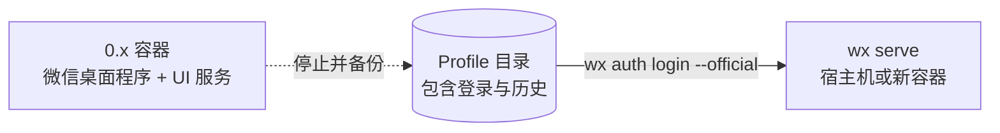

import { Aside, Steps, Tabs, TabItem } from '@astrojs/starlight/components';

0.x 版本在 Docker 容器内运行 Linux 版微信桌面程序并通过驱动图形界面进行操作。Native Daemon 则直接与微信底层协议交互，并能直接沿用原有的 Profile 数据文件，因此你的登录会话和历史记录都能完整保留。



<Steps>

1. **找到原 Profile 目录。** 该目录即原容器的主目录：通常为 Bind Mount 挂载目录或 Named Volume 数据卷。

   ```bash
   docker inspect OLD_CONTAINER --format '{{json .Mounts}}'
   ```

2. **停止旧容器并备份数据。** 停止前请确保所有进行中的发送已结束。请妥善保存原容器及数据卷，切勿直接删除。

   ```bash
   docker stop OLD_CONTAINER
   # 若为 Named Volume 数据卷：
   docker run --rm -v OLD_VOLUME:/src:ro -v "$PWD":/out busybox \
     tar -czf /out/wechat-profile-backup.tgz -C /src .
   # 若为 Bind Mount 挂载目录：
   tar -czf wechat-profile-backup.tgz -C /path/to/old/bind-mount .
   ```

3. **将 Native Daemon 指向该 Profile。**

   <Tabs>
   <TabItem label="宿主机运行 Daemon">

   [安装 `wx`](/zh-cn/setup/install/)，启动 `wx serve`，然后在第二个终端中执行：

   ```bash
   wx auth login --official=/path/to/old/bind-mount
   ```

   如果原本使用的是 Named Volume，请先将其解压复制到宿主机的某个目录，或参考下方的容器方案。

   </TabItem>
   <TabItem label="容器中运行 Daemon">

   参考 [Compose 示例](/zh-cn/setup/run/#docker-compose)，将旧数据卷挂载进新服务：

   ```yaml
   services:
     agent-wechat-native:
       volumes:
         - old-home:/profiles/wechat
   volumes:
     old-home:
       external: true
       name: YOUR_OLD_VOLUME
   ```

   ```bash
   wx --server-name box auth login --official=/profiles/wechat
   ```

   </TabItem>
   </Tabs>

4. **在修改其他配置前，先验证聊天记录和联系人。**

   ```bash
   wx accounts list
   wx messages list filehelper --limit 5
   ```

5. **更新 OpenClaw 配置**（如果使用了 OpenClaw）。将旧版的 `serverUrl` 与 `token` 配置替换为 `native` 配置块，参考 [OpenClaw 快速接入](/zh-cn/openclaw/setup/)。移除旧的 `serverUrl`、`token`、`pollIntervalMs` 以及 `authPollIntervalMs`。保留 `dmPolicy`、`allowFrom` 和 `groups` 设置，在通道启动后确认功能正常。

</Steps>

## 版本变更对照

| 0.x 版本 | 1.x 原生版本 |
| --- | --- |
| `wx up` / `wx down` 管理容器 | `wx serve` 或 `wx daemon start` |
| API 路径为 `/api` | API 路径为 `/v1`，具备全新路由与 ID 规范。详见 [HTTP API](/zh-cn/use/api/)。 |
| OpenClaw 配置 `serverUrl` + `token` | OpenClaw 配置 `native` 块与令牌引用 |
| 屏幕截图、VNC 桌面、窗口焦点选择 | 已移除；Daemon 纯协议运行，无图形界面 |
| Wechaty puppet 支持 | 已废弃并归档 |
| 代理网络配置 | 暂不支持 |

<Aside title="使用提示">
- **账号 ID 采用新规范。** 请使用 `wx accounts list` 返回的新 ID，不再使用旧的 Session ID。
- **不再需要旧版的 `agent.db`。** Daemon 的内部运行时状态存储在独立的数据目录中。
- **权限注意：** Native 镜像以 UID 10001 运行；你的旧 Profile 可能归属其他用户。建议赋予其读取写权限，避免盲目递归修改所属用户。
- **回滚操作：** 停止 Daemon，将第 2 步制作的备份解压还原到旧容器中。请勿直接用旧版客户端读取已被 Daemon 修改过的文件。
</Aside>
