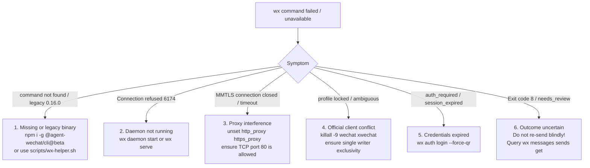

# Agent WeChat CLI (`wx`) Complete Operational Guide

This skill provides AI agents and automation scripts with complete workflows, command specifications, and best practices for managing and automating native WeChat via the `wx` command-line interface and daemon.

---

## 1. Core Operating Principles and Guardrails

Before executing any `wx` command, keep these mandatory rules in mind:

1. **Binary invocation precedence**:
   * Prefer using the globally installed `wx` in the system `PATH`.
   * If in a local source repository without a global install, use the locally built native binary (e.g. `packages/native-client-rust/target/debug/wx` or `packages/native-client-rust/target/release/wx`), or invoke via the helper script `packages/skills/agent-wechat/scripts/wx-helper.sh`.
   * Calling `pnpm cli` also forwards to the local CLI build.
2. **Always prefer structured JSON output**:
   * For automation and agent calls, **always pass the `--json` flag** (e.g. `wx --json status`) for stable, machine-readable JSON output.
3. **Multi-account context**:
   * When multiple accounts are configured, explicitly target an account with `--account <ACCOUNT_ID_OR_ALIAS>`, or set a default via `wx accounts default <ACCOUNT_ID>`.
4. **The One-Writer Rule**:
   * When using `--official` to take over an official WeChat profile directory, **ensure the official WeChat desktop app is completely stopped**. Two processes must never write to the same profile at the same time.
5. **Guard against blind retries on uncertain outcomes (`needs_review`)**:
   * When a command exits with code `8` or returns a status of `needs_review`, the request reached the network but the final remote outcome is unconfirmed. **Never blindly re-send the payload.** Instead, poll and verify using the returned `idempotency_key`, `operation_id`, or `send_id`.

---

## 2. Common Workflows and Commands

### 1. Daemon and Service Management

| Task | Command Example | Key Notes |
| :--- | :--- | :--- |
| **Start daemon in background** | `wx daemon start` | Starts the daemon in the background (default port `127.0.0.1:6174`) |
| **Check daemon status** | `wx daemon status` | Displays daemon running status, PID, uptime, and port |
| **View daemon logs** | `wx daemon logs` / `wx daemon logs --follow` | Reads running logs, with optional follow streaming |
| **Stop daemon** | `wx daemon stop` | Gracefully terminates daemon and releases locks without signing out |
| **Run in foreground** | `wx serve` / `wx serve --listen 127.0.0.1:8765` | Runs the server in foreground for debugging; Ctrl+C to exit |
| **Show effective config** | `wx config show` | Displays resolved client/server paths and data directories |

### 2. Authentication and Login

```mermaid
flowchart TD
  Start[Sign in to WeChat] --> Check{Existing official profile?}
  Check -->|Yes (Recommended on Linux)| Official["wx auth login --official=/path/to/profile"]
  Check -->|No / Standalone| QR["wx auth login --strategy=qr --qr-output=/tmp/qr.png"]
  Official --> Wait[Confirm prompt on mobile phone]
  QR --> Scan[Scan QR code on mobile WeChat and confirm]
  Wait --> Success[Login successful: session keys and sync cursor established]
  Scan --> Success
```

* **Take over an existing official profile** (Linux desktop in-place login without QR scan):
  ```bash
  # Ensure the official WeChat client is closed first!
  wx auth login --official
  # Or specify the exact profile path:
  wx auth login --official=/home/user/.xwechat/xwechat_files/wxid_xxxx
  ```
* **QR code login and save image**:
  ```bash
  wx auth login --strategy=qr --qr-output=/tmp/wechat-login.png
  ```
* **Detached asynchronous login (ideal for automation)**:
  ```bash
  # 1. Start detached login challenge and capture operation ID
  wx auth login --strategy=qr --detach
  # 2. Fetch the QR code image
  wx auth qr <OPERATION_ID> --output=/tmp/qr.png
  # 3. Poll operation status until confirmed
  wx auth operation <OPERATION_ID>
  ```
* **Disconnect and logout**:
  * `wx auth disconnect`: Closes the network connection and event stream while preserving saved credentials.
  * `wx auth logout`: Sends a logout request to WeChat servers and revokes local credentials.
  * `wx auth forget --yes`: Removes local credentials while retaining chat history and databases.

### 3. Messaging

All message sending commands use `wx messages send <THREAD_OR_CONTACT>`:

* **Send text message**:
  ```bash
  wx messages send filehelper --text "Hello, File Transfer!"
  ```
* **Send image**:
  ```bash
  wx messages send filehelper --image /absolute/path/to/image.jpg
  ```
* **Send document / file**:
  ```bash
  wx messages send filehelper --file /absolute/path/to/document.pdf
  ```
* **Send video**:
  ```bash
  # quality options: normal (processed for playback), original (preserves source video)
  wx messages send filehelper --video /path/to/video.mp4 --video-quality normal
  ```
* **Send voice message (SILK format)**:
  ```bash
  wx messages send filehelper --voice /path/to/voice.silk
  ```
* **Send link card**:
  ```bash
  wx messages send filehelper --share "https://github.com" --title "GitHub" --description "Code hosting platform"
  ```
* **Mention group members**:
  ```bash
  # Mention specific member(s)
  wx messages send 12345678@chatroom --text "Please check the update" --mention wxid_abc123 --mention wxid_def456
  # Mention all members (@all, requires group admin permissions)
  wx messages send 12345678@chatroom --text "Notice to everyone" --mention-all
  ```
* **Quoted reply**:
  ```bash
  wx messages send filehelper --text "Received and resolved!" \
    --quote-message-id "local_msg_id_123" \
    --quote-server-id "8899001122334455"
  ```
* **Recall sent message (within 2-minute window)**:
  ```bash
  wx messages recall <MSG_LOCAL_ID> --server-id <EXACT_SERVER_ID>
  ```
* **Download media attachments**:
  ```bash
  # quality options: best, thumbnail, standard, original, full
  wx messages media <THREAD_ID> <MSG_ID> --quality best --output /tmp/downloaded.jpg
  ```

### 4. Message Sync and History

* **Incremental sync (force alignment with cloud)**:
  ```bash
  wx sync
  ```
* **List message history with pagination**:
  ```bash
  wx messages list filehelper --limit 50
  # Page with next cursor:
  wx messages list filehelper --limit 50 --cursor "12345678"
  ```
* **Get details of a single message**:
  ```bash
  wx messages get filehelper <MSG_LOCAL_ID>
  ```
* **Mark chat as read**:
  ```bash
  wx messages read <THREAD_ID> --expected-version <OBSERVED_READ_VERSION>
  ```

### 5. Chat and Thread Management

* **List active conversations**:
  ```bash
  wx chats list --limit 20
  ```
* **Pin / unpin conversation**:
  ```bash
  wx chats pin <THREAD_OR_ROOM_ID>
  wx chats unpin <THREAD_OR_ROOM_ID>
  ```
* **Mute / unmute notifications**:
  ```bash
  wx chats mute <THREAD_OR_ROOM_ID>
  wx chats unmute <THREAD_OR_ROOM_ID>
  ```
* **Search conversations**:
  ```bash
  wx chats find "Project Team"
  ```

### 6. Group Administration and Members

* **Create new group chat** (initial 2 to 40 members):
  ```bash
  wx groups create wxid_member1 wxid_member2 --name "Project Alpha"
  ```
* **Rename group**:
  ```bash
  wx groups rename <ROOM_ID> "New Group Name"
  ```
* **Set own group nickname**:
  ```bash
  wx groups my-name <ROOM_ID> "Alice @ Support"
  ```
* **Manage members (add / remove / list)**:
  ```bash
  # Add members
  wx groups members add <ROOM_ID> wxid_user1 wxid_user2
  # Remove members
  wx groups members remove <ROOM_ID> wxid_user3
  # List all members
  wx groups members list <ROOM_ID>
  ```
* **Clear group announcement**:
  ```bash
  wx groups clear-announcement <ROOM_ID>
  ```
* **Leave group**:
  ```bash
  wx groups leave <ROOM_ID>
  ```

### 7. Contacts and Avatars

* **List or search contacts**:
  ```bash
  wx contacts list --limit 50
  wx contacts search "Bob"
  ```
* **Look up online contact or group profile**:
  ```bash
  wx contacts lookup-contacts wxid_12345678
  wx contacts lookup-group 12345678@chatroom
  ```
* **Export contact or group avatar**:
  ```bash
  wx contacts avatar wxid_12345678 --output /tmp/avatar.jpg --refresh
  ```

### 8. Real-time Events

* **Watch events stream (messages, reads, recalls, contact updates)**:
  ```bash
  wx events watch
  # Stream events after a cursor and persist cursor to file
  wx events watch --after 0 --cursor-file /tmp/wechat-cursor.txt
  ```
* **Acknowledge consumed events (ACK)**:
  ```bash
  wx events ack --consumer my_bot --through "100234"
  ```

### 9. Token Management

Issue restricted API tokens to safely delegate capabilities to downstream agents or scripts:
* **List tokens**: `wx tokens list`
* **Create restricted token**:
  ```bash
  # Available scopes: read, media, send, read-state, login, admin
  wx tokens create "bot-token" --accounts my_account --scopes read send
  ```
* **Revoke token**: `wx tokens revoke <TOKEN_ID>`

### 10. Low-level Store and Offline Maintenance

*Ensure both the daemon and official WeChat app are stopped before running offline store commands:*
* **Attach an existing offline profile**:
  ```bash
  wx store attach --account my_acc --path /path/to/official-home --source-stopped
  ```
* **Export profile data**:
  ```bash
  wx store export --account my_acc --destination /backup/wechat-export --source-stopped
  ```
* **Repair pending writeback media cache**:
  ```bash
  wx jobs repair-writeback --limit 50
  ```

---

## 3. Troubleshooting and Remediation

When `wx` commands fail, the daemon rejects connections, or logins expire, follow these diagnostic steps:

### 1. One-Click Health Check
Run the bundled diagnostic tool to identify root causes:
```bash
packages/skills/agent-wechat/scripts/wx-helper.sh --doctor
```

### 2. Decision Tree for Common Failures



* **Binary missing or outdated**:
  * If executing shows deprecated Docker subcommands (`up/down/screenshot`), an old 0.x package is present in `PATH`.
  * Use `packages/skills/agent-wechat/scripts/wx-helper.sh` to forward to the native 1.x build.
  * Or install the latest release via `npm install -g @agent-wechat/cli@beta`.
* **Daemon connection refused (`127.0.0.1:6174`)**:
  * Start the daemon in the background with `wx daemon start` or in foreground with `wx serve`.
* **MMTLS handshake timeout (`MMTLS deadline exceeded`)**:
  * WeChat protocol uses native TCP:80. Generic HTTP proxies break MMTLS packets.
  * Run `unset http_proxy https_proxy all_proxy` to bypass proxy interference.
* **Official client conflict / data lock (`profile locked`)**:
  * The official client must be closed completely: `killall -9 wechat xwechat`.
* **Full troubleshooting guide**: See [**Troubleshooting Reference**](references/troubleshooting.md).

---

## 4. Reference Documentation Index

For exhaustive command options, error codes, and step-by-step runbooks:
* 🛠️ [**Troubleshooting & Remediation Guide**](references/troubleshooting.md)
* 📖 [**Complete CLI Reference and Options**](references/cli-reference.md)
* ⚠️ [**Exit Codes & Uncertain Outcome Handling**](references/exit-codes.md)
* 💡 [**Production & Automation Runbooks**](examples/runbooks.md)
