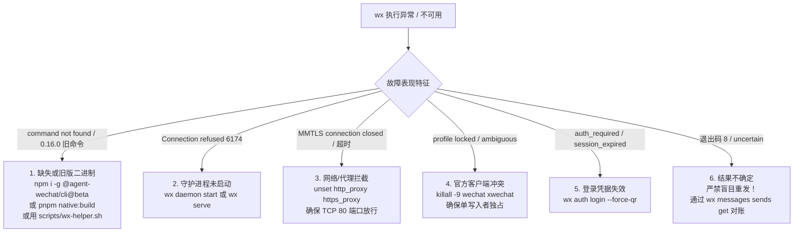

# Agent WeChat CLI (`wx`) 操作全能指南

本 Skill 提供了通过 `wx` 命令行工具全面操作和管理微信原生的完整工作流、命令规范与最佳实践。

---

## 一、 核心操作原则与运行准则

在执行任何 `wx` 命令前，必须牢记以下核心规则：

1. **二进制调用优先级**：
   * 优先使用系统 PATH 中已安装的 `wx`；
   * 若本地处于源码开发工作区且未安装全局 CLI，则使用本地构建的可执行文件（如 `packages/native-client-rust/target/debug/wx` 或 `packages/native-client-rust/target/release/wx`）；
   * 通过 `pnpm cli` 也可调用本地构建的 CLI。
2. **结构化输出推荐**：
   * 在脚本或 Agent 自动化执行时，**推荐在全局加上 `--json` 参数**（例如 `wx --json status`），以获得稳定的 JSON 结构输出。
3. **多账号标识与上下文**：
   * 若系统配置了多个微信账号，必须通过 `--account <ACCOUNT_ID_OR_ALIAS>` 指定目标账号，或先执行 `wx accounts default <ACCOUNT_ID>` 设置默认账号。
4. **官方 Profile 单写入者铁律（One-Writer Rule）**：
   * 在使用 `--official` 接管官方微信 Profile 前，**必须确保官方微信客户端已彻底关闭**；绝不能两个程序同时写入同一 Profile。
5. **不确定结果（Uncertain / NeedsReview）防重复原则**：
   * 当命令返回退出码 `8` 或状态为 `needs_review` 时，表示请求已提交但结果尚未最终确定；**切勿盲目自动重试发送**，应通过回执 ID 或查询状态核实。

---

## 二、 常用工作流速查导航

### 1. 守护进程与服务管理 (Daemon & Serve)

| 操作目标 | 命令示例 | 关键说明 |
| :--- | :--- | :--- |
| **后台启动守护进程** | `wx daemon start` | 后台启动守护进程，默认监听 `127.0.0.1:6174` |
| **检查守护进程状态** | `wx daemon status` | 检查守护进程运行状态、PID 及端口 |
| **查看守护进程日志** | `wx daemon logs` / `wx daemon logs --follow` | 查看运行日志，支持实时跟踪输出 |
| **停止守护进程** | `wx daemon stop` | 优雅停止守护进程并释放文件锁，不会登出微信账号 |
| **前台运行服务** | `wx serve` / `wx serve --listen 127.0.0.1:8765` | 在前台保持运行，输出调试日志，Ctrl+C 退出 |
| **查看当前配置解析**| `wx config show` | 查看生效的服务端与客户端路径及持久化存储位置 |

### 2. 账号认证与登录工作流 (Authentication)

```mermaid
flowchart TD
  Start[登录微信] --> Check{是否有现成官方 Profile?}
  Check -->|是 (推荐 Linux 平台)| Official["wx auth login --official=/path/to/profile"]
  Check -->|否 / 独立登录| QR["wx auth login --strategy=qr --qr-output=/tmp/qr.png"]
  Official --> Wait[手机端微信弹出确认提示并点击同意]
  QR --> Scan[手机微信扫描该二维码并点击确认]
  Wait --> Success[登录成功, 换取会话秘钥与初始 SyncKey]
  Scan --> Success
```

* **接管现有的官方客户端 Profile**（Linux 原地免扫码直接登录）：
  ```bash
  # 必须先关闭官方客户端！
  wx auth login --official
  # 或指定具体 Profile 路径：
  wx auth login --official=/home/user/.xwechat/xwechat_files/wxid_xxxx
  ```
* **二维码扫码登录并输出图片**：
  ```bash
  wx auth login --strategy=qr --qr-output=/tmp/wechat-login.png
  ```
* **分离式异步登录（适合自动化脚本）**：
  ```bash
  # 1. 提交异步登录挑战，获取操作 ID (OPERATION_ID)
  wx auth login --strategy=qr --detach
  # 2. 拉取当前二维码图片
  wx auth qr <OPERATION_ID> --output=/tmp/qr.png
  # 3. 查看扫码状态与等待确认结果
  wx auth operation <OPERATION_ID>
  ```
* **退出登录与断开连接**：
  * `wx auth disconnect`：断开当前网络连接与流监听，但保留已保存的设备信任与登录态；
  * `wx auth logout`：向微信服务器发送登出请求，持久化吊销本地凭证；
  * `wx auth forget --yes`：删除本地登录态认证信息，但保留本地消息历史与数据库。

### 3. 消息发送与操作 (Messaging)

所有发送命令均通过 `wx messages send <THREAD_OR_CONTACT>` 执行：

* **发送纯文本**：
  ```bash
  wx messages send filehelper --text "你好，文件传输助手！"
  ```
* **发送图片**：
  ```bash
  wx messages send filehelper --image /absolute/path/to/image.jpg
  ```
* **发送文件 / 文档**：
  ```bash
  wx messages send filehelper --file /absolute/path/to/document.pdf
  ```
* **发送视频**：
  ```bash
  # normal: 预处理适合播放的视频; original: 附带原始高清视频
  wx messages send filehelper --video /path/to/video.mp4 --video-quality normal
  ```
* **发送语音留言（SILK 格式）**：
  ```bash
  wx messages send filehelper --voice /path/to/voice.silk
  ```
* **发送外链分享卡片**：
  ```bash
  wx messages send filehelper --share "https://github.com" --title "GitHub" --description "代码托管平台"
  ```
* **群聊中 `@` 提醒成员**：
  ```bash
  # 提醒单个或多个成员
  wx messages send 12345678@chatroom --text "请查看最新通知" --mention wxid_abc123 --mention wxid_def456
  # 提醒群内全员 (@所有人，需管理员/群主权限)
  wx messages send 12345678@chatroom --text "全员注意" --mention-all
  ```
* **引用回复某条消息（Quote Reply）**：
  ```bash
  wx messages send filehelper --text "收到，已处理！" \
    --quote-message-id "local_msg_id_123" \
    --quote-server-id "8899001122334455"
  ```
* **撤回已发送的消息（2分钟内）**：
  ```bash
  wx messages recall <MSG_LOCAL_ID> --server-id <EXACT_SERVER_ID>
  ```
* **下载消息中的多媒体附件**：
  ```bash
  # quality 可选: best, thumbnail, standard, original, full
  wx messages media <THREAD_ID> <MSG_ID> --quality best --output /tmp/downloaded.jpg
  ```

### 4. 消息同步与历史查询 (Sync & History)

* **执行增量同步（强制与云端对齐）**：
  ```bash
  wx sync
  # 或通过 messages 子命令
  wx messages sync
  ```
* **分页拉取指定聊天的历史消息**：
  ```bash
  wx messages list filehelper --limit 50
  # 使用游标翻页
  wx messages list filehelper --limit 50 --cursor "12345678"
  ```
* **获取单条消息详情**：
  ```bash
  wx messages get filehelper <MSG_LOCAL_ID>
  ```
* **将会话标记为已读**：
  ```bash
  wx messages read <THREAD_ID> --expected-version <OBSERVED_READ_VERSION>
  ```

### 5. 聊天会话管理 (Chats & Threads)

* **列出会话列表**：
  ```bash
  wx chats list --limit 20
  # 查看置顶和未读状态
  wx threads
  ```
* **置顶 / 取消置顶会话**：
  ```bash
  wx chats pin <THREAD_OR_ROOM_ID>
  wx chats unpin <THREAD_OR_ROOM_ID>
  ```
* **静音（消息免打扰）/ 取消静音**：
  ```bash
  wx chats mute <THREAD_OR_ROOM_ID>
  wx chats unmute <THREAD_OR_ROOM_ID>
  ```
* **搜索聊天会话**：
  ```bash
  wx chats find "项目组"
  ```

### 6. 群聊与成员运维 (Groups & Members)

* **创建新群聊**（初始成员 2 至 40 人）：
  ```bash
  wx groups create wxid_member1 wxid_member2 --name "工作讨论组"
  ```
* **重命名群聊**：
  ```bash
  wx groups rename <ROOM_ID> "新群名"
  ```
* **修改自己在群内的显示昵称（群名片）**：
  ```bash
  wx groups my-name <ROOM_ID> "张三@运营"
  ```
* **群成员管理（拉人 / 踢人）**：
  ```bash
  # 添加成员进群
  wx groups members add <ROOM_ID> wxid_user1 wxid_user2
  # 从群中移除成员
  wx groups members remove <ROOM_ID> wxid_user3
  # 列出群内全部成员
  wx groups members list <ROOM_ID>
  ```
* **清除群公告**：
  ```bash
  wx groups clear-announcement <ROOM_ID>
  ```
* **主动退出群聊**：
  ```bash
  wx groups leave <ROOM_ID>
  ```

### 7. 联系人管理与头像导出 (Contacts)

* **列出联系人 / 搜索联系人**：
  ```bash
  wx contacts list --limit 50
  wx contacts search "张三"
  ```
* **根据微信号/群号精确拉取最新在线资料**：
  ```bash
  wx contacts lookup-contacts wxid_12345678
  wx contacts lookup-group 12345678@chatroom
  ```
* **导出联系人或群头像到本地**：
  ```bash
  wx contacts avatar wxid_12345678 --output /tmp/avatar.jpg --refresh
  ```

### 8. 实时事件流与监听 (Events)

* **实时监听微信事件（新消息、已读、撤回、联系人更新）**：
  ```bash
  wx events watch
  # 从指定游标后开始监听，并将游标持久化到本地文件
  wx events watch --after 0 --cursor-file /tmp/wechat-cursor.txt
  ```
* **确认消费事件（ACK）**：
  ```bash
  wx events ack --consumer my_bot --through "100234"
  ```

### 9. 访问令牌管理 (Tokens)

通过创建受限的 API Token，可以安全地将指定账号的受限能力分发给下游脚本或 Agent：
* **列出 Token**：`wx tokens list`
* **创建受限 Token**：
  ```bash
  # 可授权的 scope: read, media, send, read-state, login, admin
  wx tokens create "bot-token" --accounts my_account --scopes read send
  ```
* **吊销 Token**：`wx tokens revoke <TOKEN_ID>`

### 10. 底层存储与离线维护 (Store)

*在执行离线 `store` 命令前，必须确保守护进程和官方微信客户端均已停止：*
* **挂载已有的离线 Profile**：
  ```bash
  wx store attach --account my_acc --path /path/to/official-home --source-stopped
  ```
* **导入 / 导出 Profile 数据**：
  ```bash
  wx store export --account my_acc --destination /backup/wechat-export --source-stopped
  ```
* **修复未回写的多媒体文件缓存**：
  ```bash
  wx jobs repair-writeback --limit 50
  ```

---

## 三、 当 `wx` 不可用时的排查与解决方案 (Troubleshooting & Remediation)

当遇到 `wx` 命令无法执行、守护进程拒绝连接、登录失效或网络超时时，请遵循以下处置方案：

### 1. 一键自检诊断
执行 Skill 内置的健康诊断工具，快速定位故障根因：
```bash
packages/skills/agent-wechat/scripts/wx-helper.sh --doctor
```

### 2. 常见故障自愈决策表



* **二进制缺失或版本不对**：
  * 若执行显示旧版 Docker 命令（`up/down/screenshot`），说明 PATH 中存在旧版 0.x CLI；
  * 使用 `packages/skills/agent-wechat/scripts/wx-helper.sh` 自动调用 1.x 原生构建；
  * 或运行 `npm install -g @agent-wechat/cli@beta` 安装最新版。
* **守护进程连接失败（`Connection refused 127.0.0.1:6174`）**：
  * 守护进程未启动，执行 `wx daemon start` 或前台调试 `wx serve`。
* **网络与 MMTLS 握手超时（`MMTLS deadline exceeded`）**：
  * 微信协议走原生 TCP:80，常规 HTTP 代理会损坏 MMTLS 数据包；
  * 执行 `unset http_proxy https_proxy all_proxy` 避免代理拦截。
* **官方客户端冲突或数据锁冲突（`profile locked`）**：
  * 必须保证官方客户端完全关闭：`killall -9 wechat xwechat`。
* **详细排查手册**：请参阅 [**故障排查指南**](references/troubleshooting.md)。

---

## 四、 详细参考文档导航

如需查看各命令的完整参数手册、退出码含义、故障排查或实战场景剧本，请参阅：
* 🛠️ [**故障排查与应急修复指南**](references/troubleshooting.md)
* 📖 [**完整命令行手册与参数参考**](references/cli-reference.md)
* ⚠️ [**退出码与不确定状态处理机制**](references/exit-codes.md)
* 💡 [**典型场景操作 Runbooks 剧本**](examples/runbooks.md)

