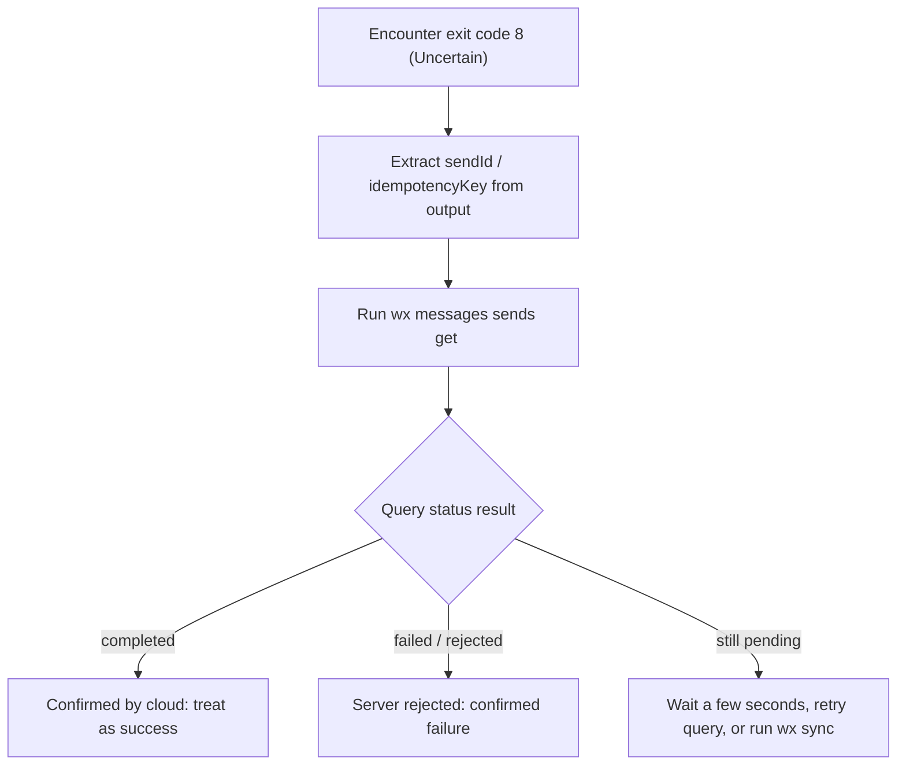

# `wx` CLI Exit Codes and Uncertain State Handling

When writing automation scripts or invoking `wx` from an AI agent, evaluate the command exit code and JSON response fields to safely handle outcomes and prevent duplicate actions.

---

## 1. Process Exit Code Table

| Exit Code | Status Name | Meaning and Scenario | Agent Action |
| :---: | :--- | :--- | :--- |
| **`0`** | **Success** | Operation succeeded. Local and remote states are confirmed. | Proceed with next task. |
| **`1`** | **Failure** | Definite failure (e.g. invalid arguments, target not found, server rejected request, network unreachable). | Inspect stderr or JSON `error` field to report or adjust parameters. May retry if appropriate. |
| **`8`** | **Uncertain / NeedsReview** | **Outcome uncertain (core safety guardrail)**.<br>The request was submitted to the network, but due to timeout, connection reset, or lost ACK, **it is unknown whether the server processed the send**. | **DO NOT BLINDLY RETRY!**<br>Never re-send the same payload immediately. Poll using the returned `idempotency_key`, `operation_id`, or `send_id`. |
| **`64`** | **Usage Error** | CLI argument parsing error (missing required arguments, incompatible options). | Fix command invocation arguments. |

---

## 2. In-Depth Guide: Handling Exit Code 8 (Uncertain / NeedsReview)

### 1. Why does Exit Code 8 happen?
In distributed instant messaging and transactional systems, network communication is subject to the **Two Generals' Problem**:
* The client sends a message or recall request to WeChat servers.
* WeChat servers receive the request, commit it to their database, and route it to recipients.
* Just before the server's acknowledgement (HTTP ACK) reaches the client, the network drops or times out.

If the client assumes failure and blindly retries sending, the recipient will receive duplicate messages, spamming group chats or causing conflicting actions.

### 2. Standard Handling Procedure for Exit Code 8

When an agent or script encounters exit code `8`:



1. **Extract IDs**: Parse `sendId`, `operationId`, or the previously supplied `idempotency_key` from the JSON output.
2. **Poll Status**:
   ```bash
   wx messages sends get <SEND_ID>
   # Or lookup by idempotency key:
   wx messages sends lookup --idempotency-key <YOUR_KEY>
   ```
3. **Reconcile via NewSync**:
   * Run `wx sync` to fetch downstream events.
   * If the message was accepted on the server, a send confirmation event will appear in the incremental sync stream.

---

## 3. `--json` Output Structure Specification

When the `--json` flag is provided, `wx` outputs structured JSON:

### 1. Success Response (Exit Code 0)
```json
{
  "outcome": "success",
  "data": {
    "messageId": "msg_local_123456",
    "serverId": "8899001122334455",
    "createdAt": 1729900000,
    "receiptState": "accepted"
  }
}
```

### 2. Uncertain Response (Exit Code 8)
```json
{
  "outcome": "uncertain",
  "receiptState": "needs_review",
  "sendId": "send_job_789abc",
  "idempotencyKey": "unique_task_001",
  "retryable": false,
  "reason": "Request submitted but response timed out after 30s"
}
```

### 3. Definite Failure Response (Exit Code 1)
```json
{
  "outcome": "failure",
  "code": 403,
  "error": "Account not authorized to send to this contact"
}
```
