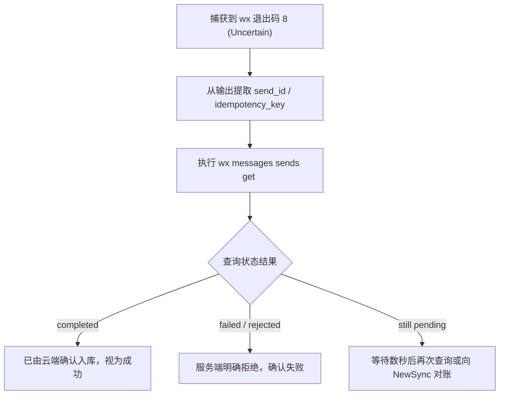

# `wx` CLI 退出码与不确定状态处理机制

在编写自动化脚本或由 Agent 调用 `wx` CLI 时，必须通过进程退出码（Exit Code）和 JSON 输出状态来精确判断执行结果，并根据安全规范采取应对策略。

---

## 一、 进程退出码清单

| 退出码 | 状态名称 | 核心含义与场景 | Agent 应对策略 |
| :---: | :--- | :--- | :--- |
| **`0`** | **Success** | 命令执行成功，所有本地及远程操作均已确认生效。 | 正常继续后续流程。 |
| **`1`** | **Failure** | 明确的操作失败（如参数校验未通过、目标不存在、服务端明确拒绝、网络不可达等）。 | 读取 stderr 或 JSON `error` 字段，排查失败原因并报错；可以根据业务逻辑决定是否重试。 |
| **`8`** | **Uncertain / NeedsReview** | **操作结果不确定（核心保护状态）**。<br>请求已发送至网络，但由于超时、连接重置或响应丢失，**无法断定服务端是否已接收并执行**。 | **严禁盲目自动重试！**<br>禁止使用相同的载荷重新发起发送；应通过返回的 `idempotency_key`、`operation_id` 或 `send_id` 进行状态轮询与核实。 |
| **`64`** | **Usage Error** | 命令行参数解析错误（缺少必填参数、参数冲突等）。 | 检查命令格式，修正调用参数。 |

---

## 二、 退出码 8（不确定状态）深度解析与处置规范

### 1. 为什么会出现退出码 8？
在即时通信与金融交易系统中，网络通信天然存在 **两军问题（Two Generals' Problem）**：
* 客户端向微信服务器发送了一条消息或撤回指令；
* 微信服务端成功接收并将消息存入核心数据库，并分发给了接收方；
* 就在服务端返回“发送成功”的 HTTP ACK 回执瞬间，客户端网络发生抖动或超时（Timeout）。

此时，如果客户端直接认定为失败并“自动重发”，会导致接收方收到两份甚至多份重复消息，在群聊中刷屏，或者在撤回指令中产生逻辑混乱。

### 2. 退出码 8 时的标准处置流程

当 Agent 或脚本捕获到退出码 `8` 时，必须执行以下排查流程：



1. **提取标识**：从 JSON 输出中提取 `sendId`、`operationId` 或先前指定的 `idempotency_key`；
2. **状态查询**：
   ```bash
   wx messages sends get <SEND_ID>
   # 或通过幂等键查找
   wx messages sends lookup --idempotency-key <YOUR_KEY>
   ```
3. **结合 NewSync 对账**：
   * 执行 `wx sync` 拉取最新的下行事件；
   * 如果该消息已在云端生效，增量同步流中会出现对应的发送确认回执。

---

## 三、 `--json` 结构化输出规范

当全局添加 `--json` 参数时，`wx` 保证将标准输出序列化为统一的 JSON 报文：

### 1. 成功响应示例
```json
{
  "outcome": "success",
  "data": {
    "messageId": "msg_local_123456",
    "serverId": "8899001122334455",
    "createdAt": 1729900000,
    "receiptState": "accepted"
  }
}
```

### 2. 不确定状态响应示例（退出码 8）
```json
{
  "outcome": "uncertain",
  "receiptState": "needs_review",
  "sendId": "send_job_789abc",
  "idempotencyKey": "unique_task_001",
  "retryable": false,
  "reason": "Request submitted but response timed out after 30s"
}
```

### 3. 明确失败响应示例（退出码 1）
```json
{
  "outcome": "failure",
  "code": 403,
  "error": "Account not authorized to send to this contact"
}
```
